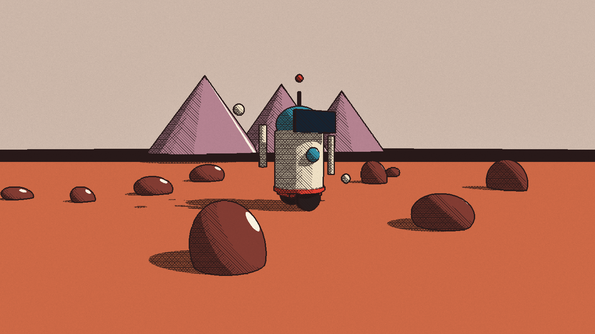
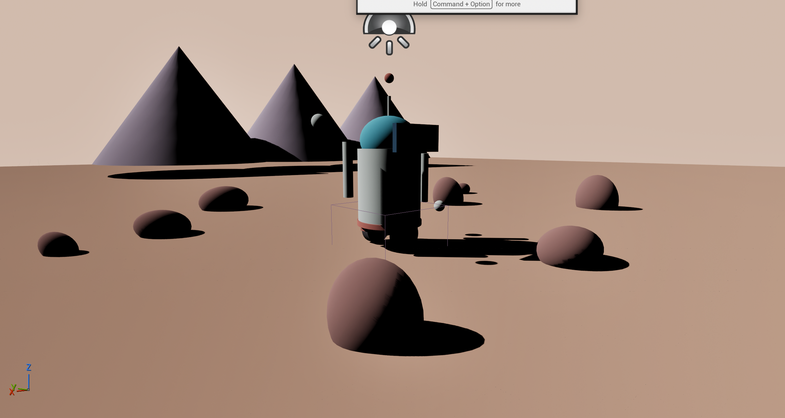
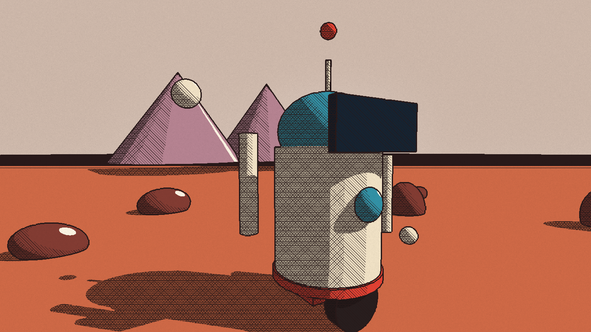

[Home](../index.md) · [Devlog](../devlog.md) · [How We Used AI](../how-we-used-ai.md) · [Play](../play.md)

# Day 0: Concept (Nov 11)

## What we built today

- **The pitch.** Kiki wrote the pitch and the gray box plan, with three
  must-haves: Scavenge, Splice and Deploy. There's one small mine level and one
  bot to restore, the Digger.
- **The project.** We set up the Unreal Engine 5.9 project (built from source
  on a Mac) and a version-control workflow.
- **The look, researched.** We studied a public tutorial on Moebius-style
  rendering by sampling it frame by frame. From that we wrote our own plan for
  the effect: ink outlines, flat colour, hatching in shadow, and paper grain.
- **The look, tested.** We tested it on a throwaway robot-on-Mars scene. The
  test ran from the evening into just after midnight. See
  [build note 0001](../entries/0001-moebius-mars.md).

## Concept sketches

*Concept sketches drawn before the build window, declared per jam rules.*

<!-- Add notebook photos to media/day-0/ and list them here:

*Caption: what the sketch shows* -->

| Sketch | Caption |
|---|---|
| *(photo coming)* | *(caption)* |

## Clip or GIF



| Before the shader | After |
|---|---|
|  |  |

## Prompts and agent steps we used

Full log: [prompts/day-0.md](../prompts/day-0.md)

```text
create a little robot on mars kinda scene and set that up like try to emulate
the full moebius effect and take some pics and show me
```

- **Agent steps:**
  - built the scene from editor Python;
  - wrote one post-process material (outlines, flat colour, hatching, grain);
  - drove the open editor live through its MCP server;
  - rendered and checked its own screenshots.

## What broke and how we fixed it

| What we saw | Cause | Fix |
|---|---|---|
| The effect never appeared | In Python, `volume.settings` returns a **copy**, so the material was never attached | Write the settings back onto the volume |
| A flat pink screen | `unreal.Rotator(a, b, c)` is roll, pitch, yaw, so the camera looked at the sky | Always pass keyword arguments |
| The player fell through the world | The sky dome's collision never actually switched off | Set its collision profile to NoCollision |
| Each change took about 5 minutes | We restarted the editor every time | Drove the open editor through its MCP server; each change now takes about 2 s |

Details: [build note 0001](../entries/0001-moebius-mars.md)

## What we cut and why

- **Outline wobble and paper grain that changes over time:** not needed to
  prove the look. Later.
- **The Mars scene itself:** it was only a shader test, so it isn't in the game.

## Tweets

<!-- Paste tweet embed code here (from tweet menu > Embed post). -->
*(none yet)*
