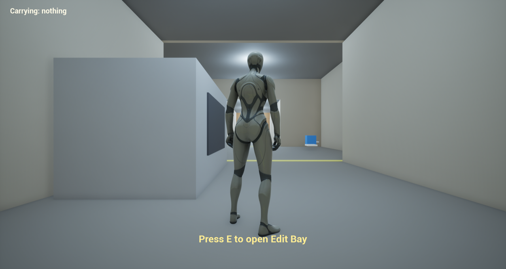
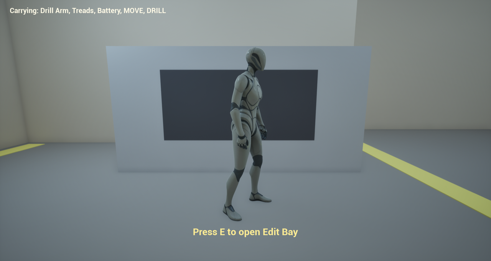
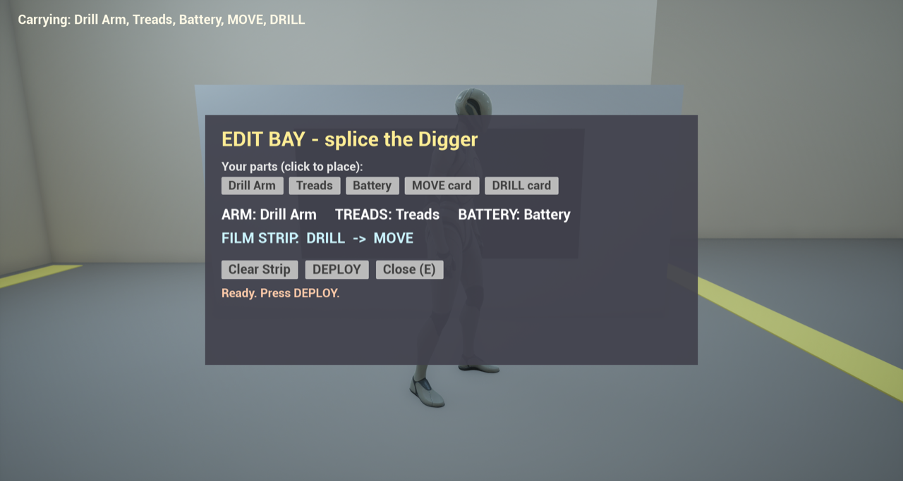
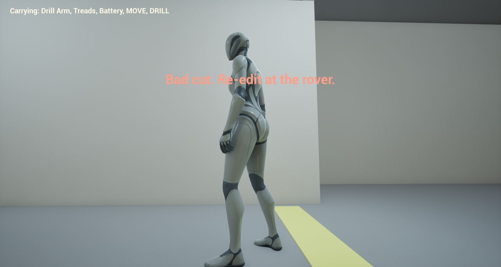
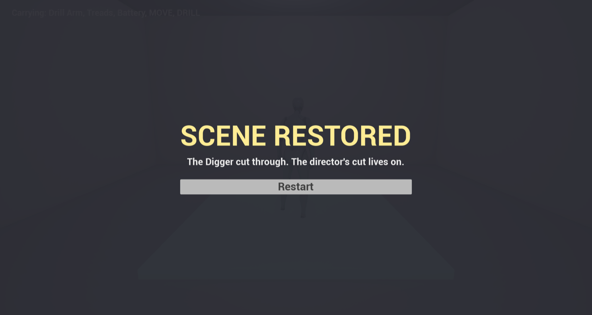
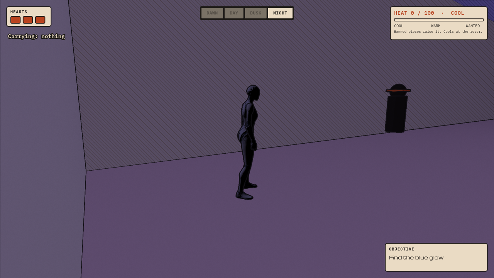
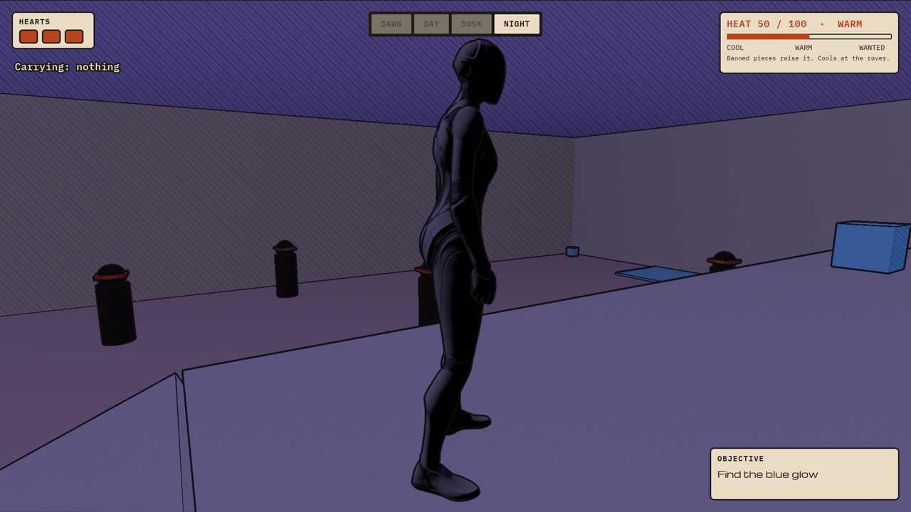
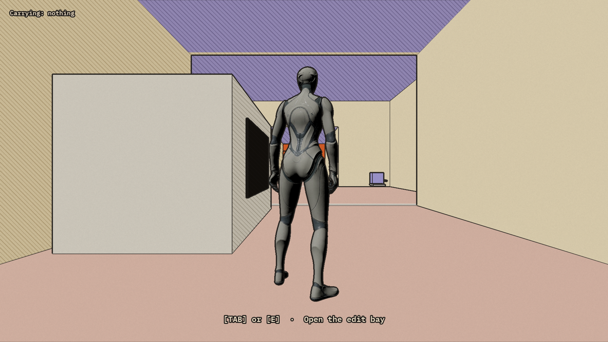
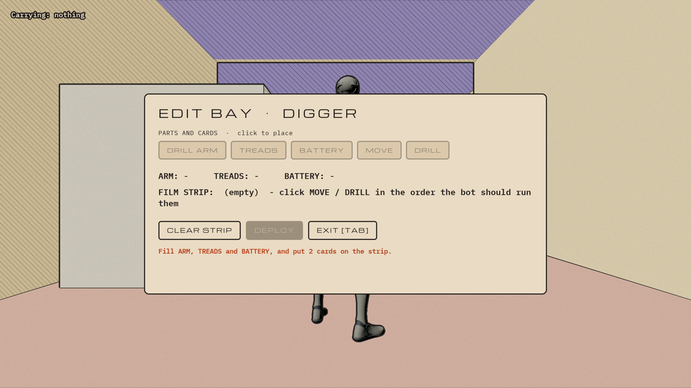
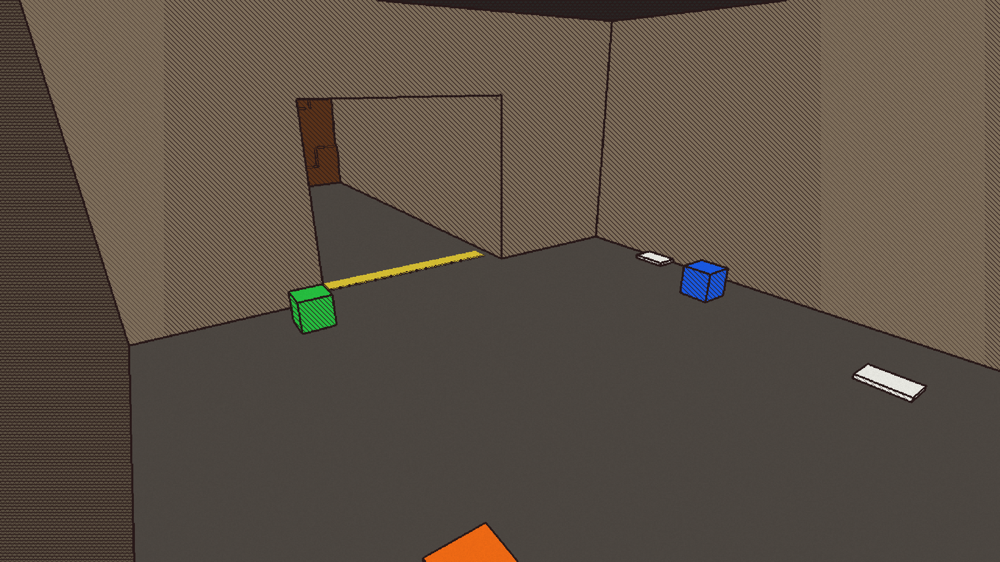

[Home](../index.md) · [Devlog](../devlog.md) · [How We Used AI](../how-we-used-ai.md) · [Play](../play.md)

# Day 1 (Nov 12, from 1:35 AM ET)

*All times are US Eastern (ET).*

## What we built today

We built the whole gray box loop from Kiki's plan, and it's playable from start
to end. Everything is Blueprints, with no C++.

| Step | What it is | Status |
|---|---|---|
| 1 | `L_Mine`: a 40 m mine with an entrance, scrap room, tunnel with a rubble wall, and exit room | Done |
| 2 | `BP_Rover` at the entrance, with the "Press E to open Edit Bay" prompt | Done |
| 3 | `BP_Fragment` pickups (Drill Arm, Treads, Battery, and the MOVE and DRILL cards), plus the "Carrying" HUD | Done |
| 4 | `WBP_EditBay`: three hardware slots, a two-slot film strip, Clear Strip, DEPLOY and Close | Done |
| 5 | `BP_Bot`, the Digger, which runs its cards in order: MOVE drives up to the rubble, DRILL cuts through it | Done |
| 6 | `BP_Rubble`. A wrong cut shows "Bad cut. Re-edit at the rover." and lets you re-cut | Done |
| 7 | `BP_EndTrigger` and the "SCENE RESTORED" screen, with a Restart button | Done |
| 8 | Day turns to night past the rubble; objective panel and phase label | Done |
| 9 | Party Room, banned pieces, Heat meter, Imperial Sweep | Done |
| 10 | Raiders, hearts, checkpoint | Done |
| Look | Flat comic materials and ink lines, the same on both web tiers | Done; art still to come |
| Web | First web build, tested in Chrome on both renderer tiers | Done |
| UI | Restyled to Kiki's Game UI board: paper, ink, Michroma, IBM Plex Mono | Style done; layout still gray-box |

**Tested by script in play mode:**
- picked up all 5 items;
- the rover prompt appeared;
- the wrong order (DRILL then MOVE) failed: the rubble stayed and the bot was removed;
- the re-cut (MOVE then DRILL) cleared all 25 rubble pieces;
- the exit pad showed SCENE RESTORED.

## Clip or GIF

| | |
|---|---|
|  |  |
|  |  |
|  |  |

The night zone, in the browser ([build note 0005](../entries/0005-night-heat-raiders.md)):

| | |
|---|---|
|  |  |

In the browser, on the web build's forward tier, with the new look and UI:

| | |
|---|---|
|  |  |

The mine with the first Moebius shader, before the look was rebuilt:



## Prompts and agent steps we used

Full log: [prompts/day-1.md](../prompts/day-1.md)

```text
We are going to sleep, so do it all in one go.  And let me see it with the
post-process shader on, too.
```

- **Agent steps:**
  - Read Kiki's plan PDF from Google Drive.
  - Built the level from a Python script.
  - Created the Blueprint classes, components and variables.
  - Built three UI widgets.
  - Wrote all the game logic in Unreal's text format for Blueprint graphs (the
    Blueprint Graph DSL), through the editor's MCP server.
  - Placed the actors.
  - Played the whole loop by script in play mode, with screenshots at every
    step.

## What broke and how we fixed it

| What we saw | Cause | Fix |
|---|---|---|
| "Could not create Blueprint" | Checking whether an asset exists by loading it leaves an empty package behind, and that blocks the create | Check the asset registry instead, and create with the asset factory |
| `AddToViewport hud` wouldn't connect | In the graph format, a single unnamed argument fills the first data pin (ZOrder), not the target | Name the target pin: write `:self hud` instead of a bare `hud` |
| Setting `bShowMouseCursor` and the bot's `Cards` failed | Same cause: positional values went into the wrong pins | Name every pin on setters |
| No way to break a trace's hit result in the graph format | `HitResult` has a native break function the format can't express | The mine runs straight along +X, so the bot measures its distance to the rubble on the X axis instead of tracing |
| The Moebius shader wiped out the 3D view on the web's forward tier | It read buffers that tier doesn't have | Rebuilt the look as unlit comic materials plus a depth-only ink pass ([build note 0004](../entries/0004-web-build-and-look.md)) |
| Three hearts gone in under three seconds | Each raider had its own hit cooldown, and several arrived together | The player holds the cooldown instead |
| A lost banned piece was picked straight back up on respawn | Pieces reappeared before the player was moved | Move the player first |
| Couldn't test the E key by script | macOS blocks scripted keystrokes | Tested the same event directly, then pressed real E and TAB keys in the web build through a browser test |

Details: [build note 0002](../entries/0002-splice-mine-graybox.md) · [build note 0003](../entries/0003-splice-full-loop.md)

## What we cut and why

- **Inventory lives on a game-manager actor (`BP_SpliceGame`), not on the
  player.** This keeps all game state in one Blueprint, and the template
  character stays untouched.
- **The rover uses a distance check instead of an overlap box.** It needs no
  extra component and is easy to tune.
- **Line traces:** not needed for a straight tunnel.
- **Stretch goals not started:**
  - sim preview
  - a "deleted scene" clip
  - more bots
  - the town, the rail ride, and music zones

## Tweets

<!-- Paste tweet embed code here. -->
*(none yet)*
