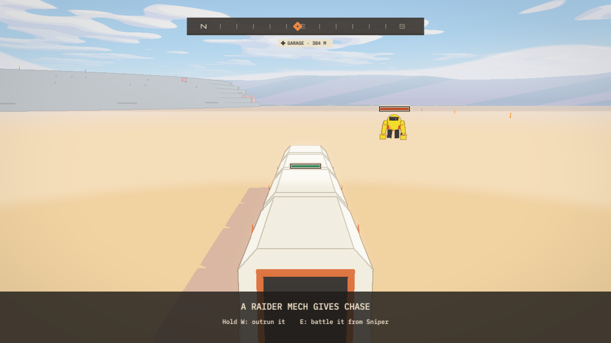

[Home](../index.md) · [Devlog](../devlog.md) · [How We Used AI](../how-we-used-ai.md) · [Play](../play.md)

# Day 2 (Nov 13)

## What we built today

The feel pass on slice 1 of the browser prototype. The run already played from
the title to SCENE RESTORED; today was about how it feels.

- Movement: sprint and the hoverboard.
- The camera blends between on foot, inside the rover, driving and the boss room, and the rover's walls stop it.
- You drive the whole rover train yourself: steer, handbrake, park, get out.
- Digger takes orders from the reticle and says so when he can't do one.
- Raiders chase the rover on the road; Imperial robots patrol.
- Two recorded playtests, each turned into a list of fixes.

Full write-up: [build note 0008](../entries/0008-feel-pass-and-three-playtests.md)

## Clip or GIF

## Prompts and agent steps we used

We didn't save this day's prompts word for word, so there is no prompt file for it.
The method is in [build note 0008](../entries/0008-feel-pass-and-three-playtests.md#tools-and-ai):
one coordinating agent, one agent a problem, one written item a complaint.

## What broke and how we fixed it

See [build note 0008](../entries/0008-feel-pass-and-three-playtests.md#what-broke).

## What we cut and why

- First person while driving. The train is too long to read from the cab; the chase camera stays.

## Tweets

<!-- Paste tweet embed code here. -->
*(none yet)*
