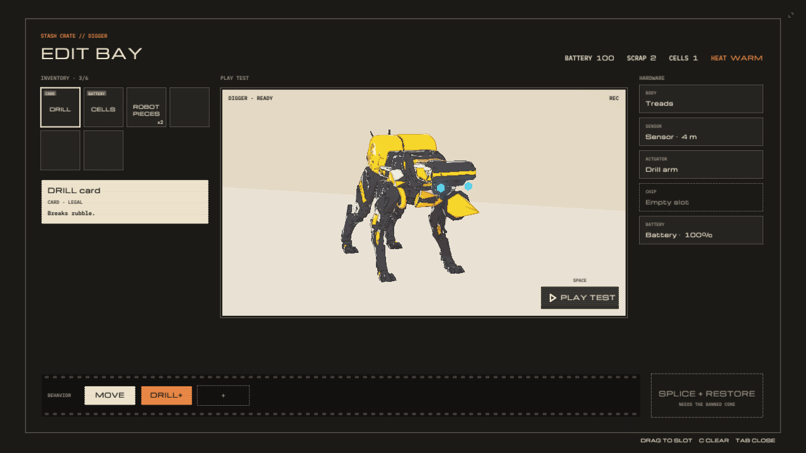
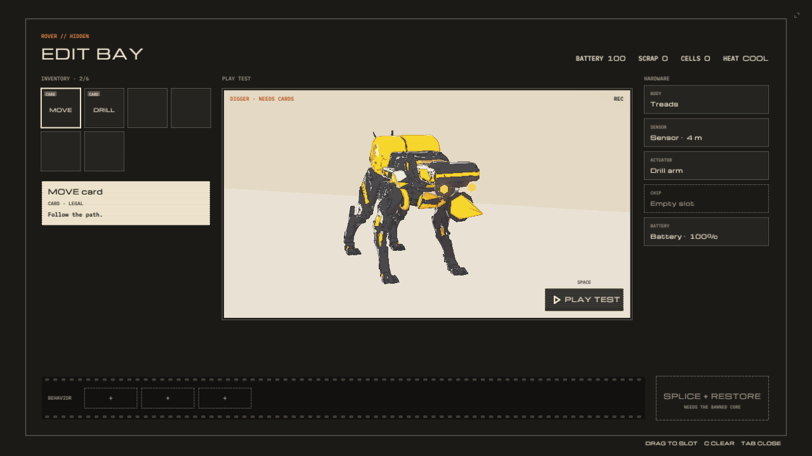

[Home](../index.md) · [Devlog](../devlog.md) · [How We Used AI](../how-we-used-ai.md) · [Play](../play.md)

# Day 3 (Nov 14)

## What we built today

- Digger walks round the solar rows by the aisles, and follows you round them.
- Hold Left Shift to sneak, with a crouched walk of its own.
- The edit bay says NEEDS CARDS when the strip is empty.
- The boss lasts: about 30 seconds for a simulated player, against 12 before.
- The camera no longer goes top-down at the mech.
- The compass leads round the parked rover train.
- An agent played the whole slice with real keys in a headless browser. Then Kiki played it (playtest 3, 13 minutes) and finished it.

Full write-up: [build note 0008](../entries/0008-feel-pass-and-three-playtests.md)

## Clip or GIF

| The bay, before | The bay, after |
|---|---|
|  |  |

## Prompts and agent steps we used

Full log: [prompts/day-3.md](../prompts/day-3.md)

```text
I want you to tell it to stop waiting so long on tests and get the thing
actually implemented. And I don't care if it's a little buggy.

Get me something where I can test all of the changes as soon as possible. So
tell it to speed up.
```

## What broke and how we fixed it

| What we saw | Cause | Fix |
|---|---|---|
| The bay said READY with no cards | READY only looked at hardware | NEEDS CARDS until the strip has one |
| The boss fell in 12 seconds | One stun could be held open | A 4-second guard after each stun |
| The compass pointed through the rover | A straight line to the target | The route graph Digger uses |
| Digger walked through the solar panels | His path search reaches 20 m; a row is 150 m | A coarse graph of the aisles |
| The test suite failed at random | Two checks replayed the run up to 14 times | One or two replays a check |
| Four fixes sat unpushed for 90 minutes | An agent waiting on full test runs | Ship first, test after |

## What we cut and why

- Nothing yet from playtest 3. It gave us 29 items and a day to go; we choose tomorrow.

## Tweets

<!-- Paste tweet embed code here. -->
*(none yet)*
