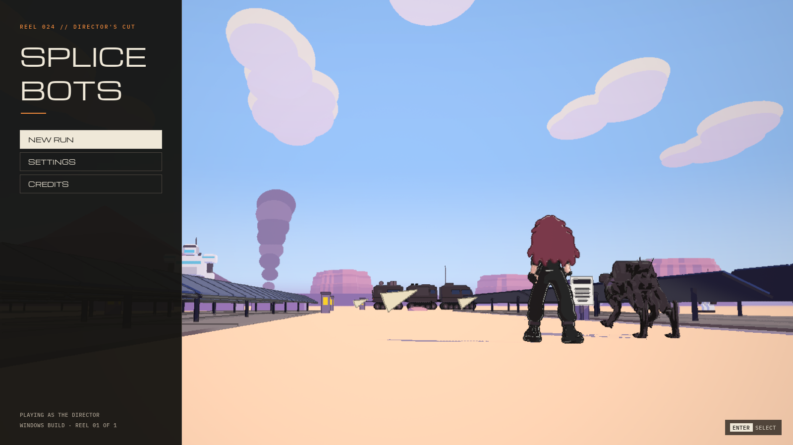
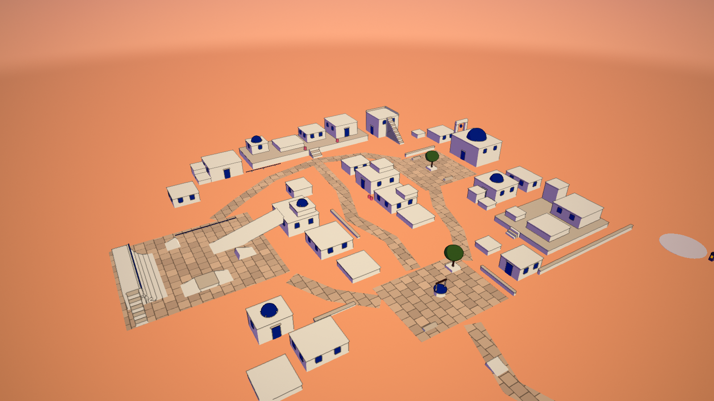
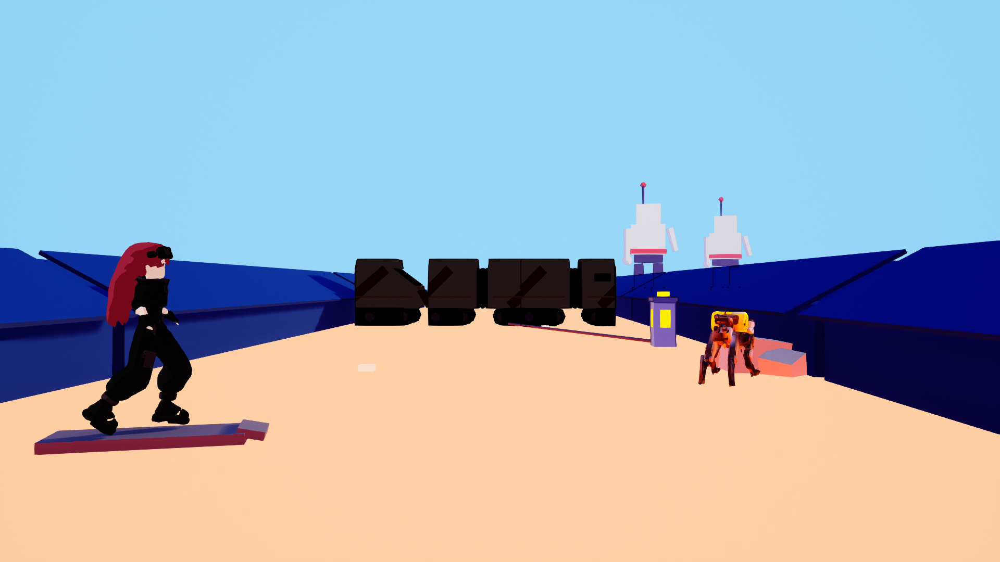
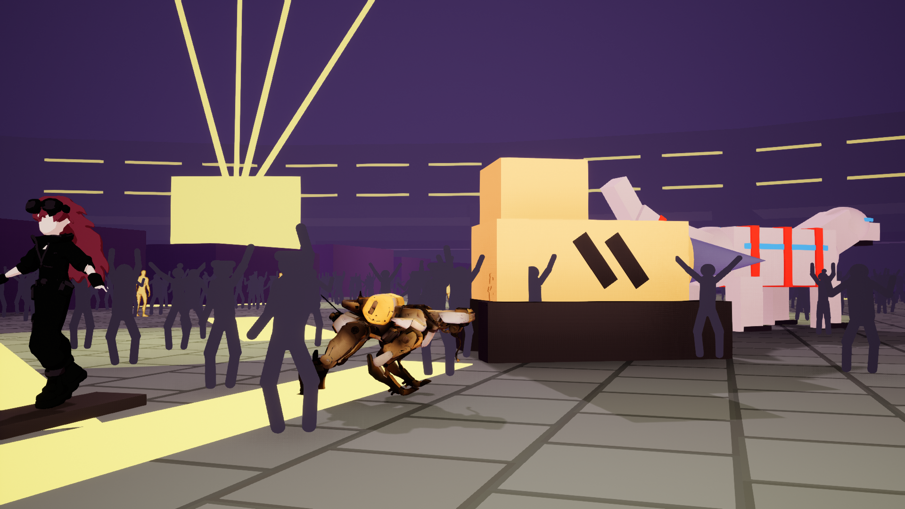
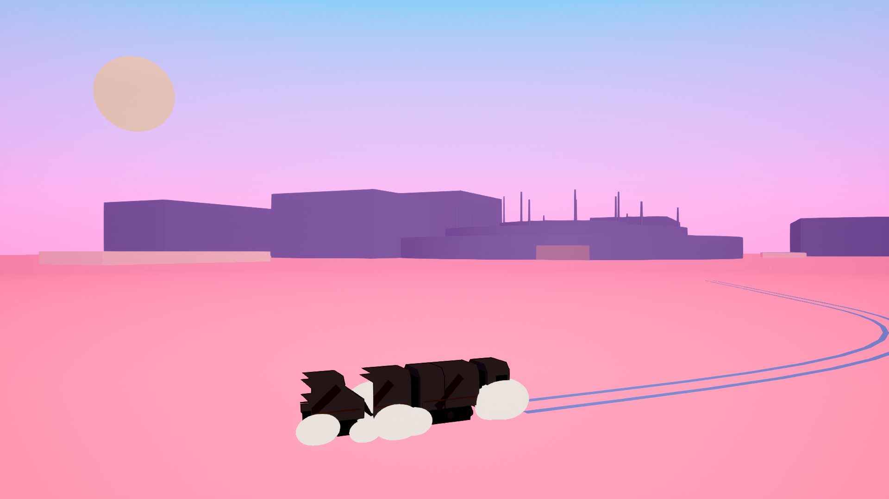
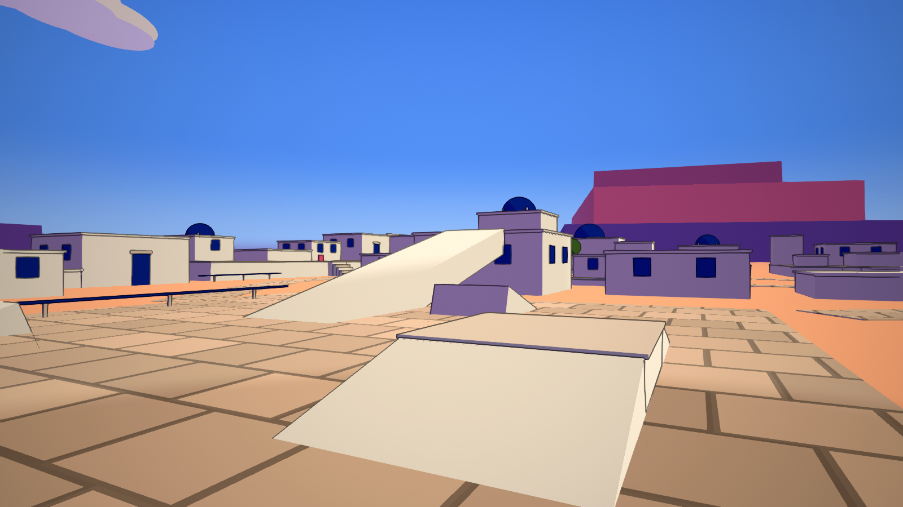

[Home](../index.md) · [Devlog](../devlog.md) · [How We Used AI](../how-we-used-ai.md) · [Play](../play.md)

# Day 4 (Nov 15)

## What we built today

- The whole slice plays start to end in Unreal Engine 5.9, rebuilt natively from the design document (3:12 AM).
- A backup release build (4:38 AM).
- From Kiki's first Unreal playtest: a title in the prototype's style, drawn hotbar icons, a crosshair, faster
  running and higher jumps, hoverboard animation and tricks, the rover's cab drives and its cars go inside, robots
  fetch parts and stay or follow, feeding a robot a battery, Esc to pause, a white Greek-style village with ramps.
- A jetpack (grey box), a 2.5x faster hoverboard, a pickup chime.
- Then Kiki's second playtest broke it, and four agents compared the prototype to the Unreal build, feature by
  feature, to find everything that was lost.

Full write-up: [build note 0009](../entries/0009-unreal-rebuild-and-the-playtest-that-broke-it.md)

## Clip or GIF

| The new title | The Greek-style village |
|---|---|
|  |  |

| On the board at the farm | The night rave |
|---|---|
|  |  |

| The drive at dusk | The village's skate plaza |
|---|---|
|  |  |

More in the [gallery in build note 0009](../entries/0009-unreal-rebuild-and-the-playtest-that-broke-it.md#whats-working-a-gallery).

## Prompts and agent steps we used

Full log: [prompts/day-4.md](../prompts/day-4.md)

## What broke and how we fixed it

| What we saw | Cause | Fix |
|---|---|---|
| She stood in a T-pose in the packaged game | Her animations were loaded by name, so the packager left them out | Added them to the cook list |
| She vanished after the rover; only the jetpack showed | Leaving the rover by any path but the normal one left her hidden | She's restored whenever she's the player again |
| Dropped into the garage without walking there | The world is split into maps that load as you cross into them | In progress: one continuous world |
| Couldn't get into the rover | Every click on the rover went to the wheel | Cab: DRIVE; cars: ENTER |
| Washed-out pink picture | Fog, a warm ground rim, still-photo colour grades in play | In progress |
| 379 tests passed on a broken build | Tests check numbers, not the picture | Every build is played before hand-over |

## What we cut and why

- Character creation: one fixed Director, as the design says.
- Submitting at 3 PM: not ready. We finished the parity work first, then submitted the 4:37 PM release build. [Build note 0010: Submitted](../entries/0010-submitted.md)

## Tweets

<!-- Paste tweet embed code here. -->
*(none yet)*
