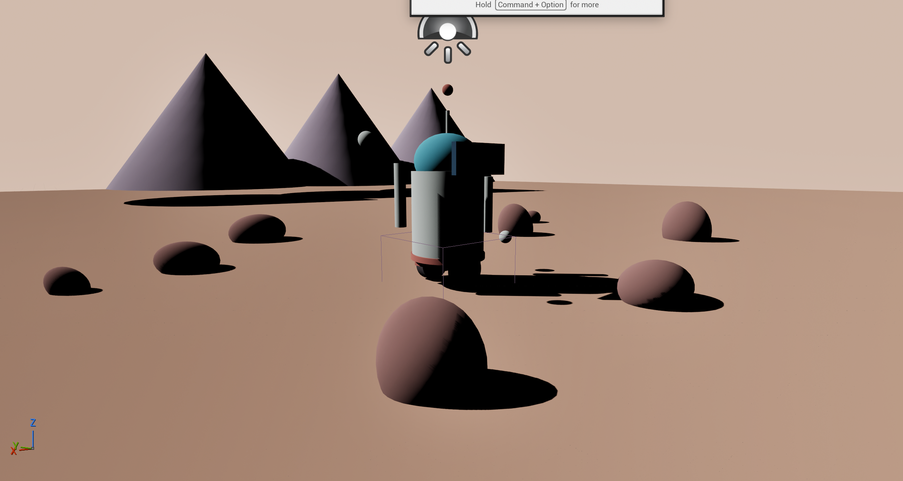
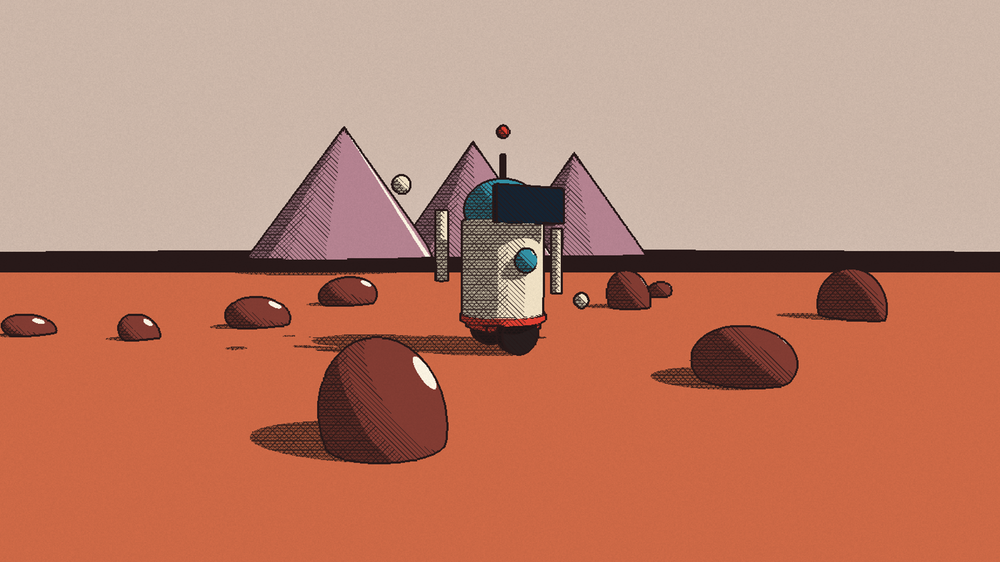
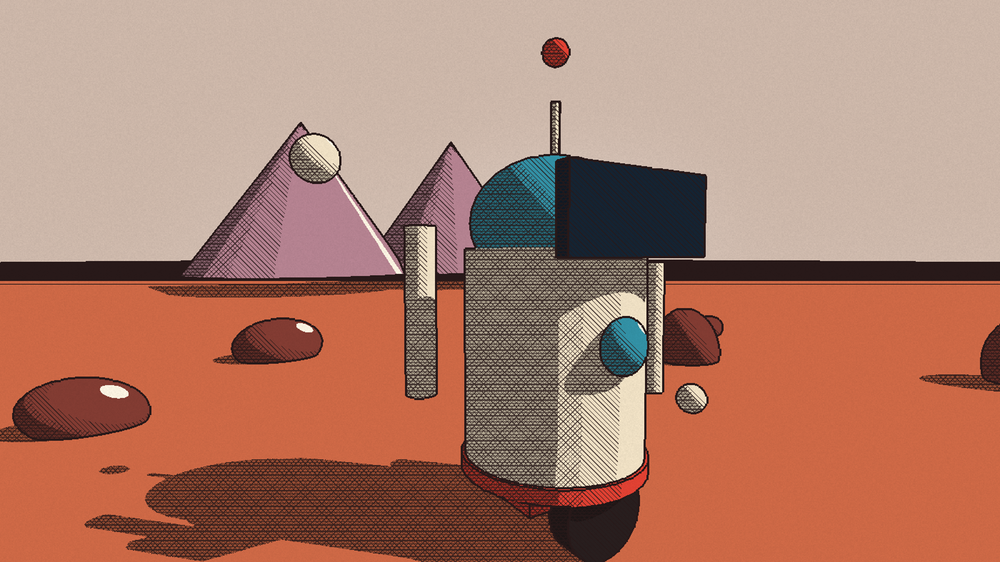
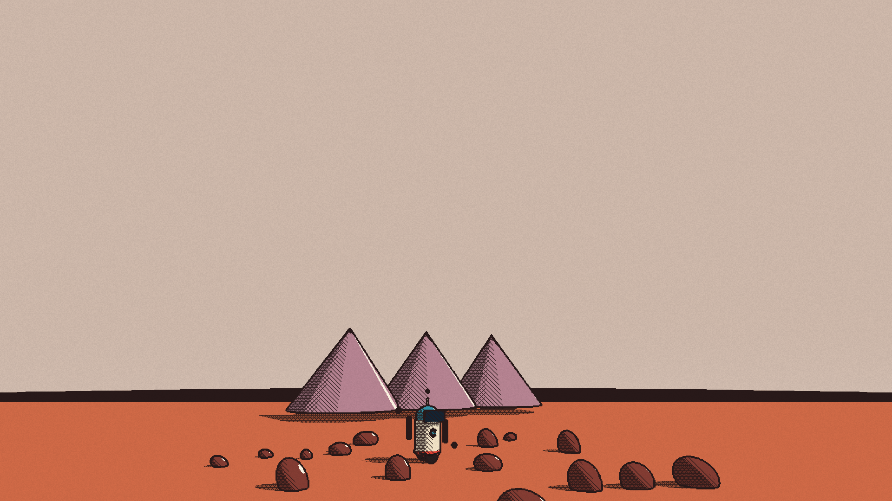
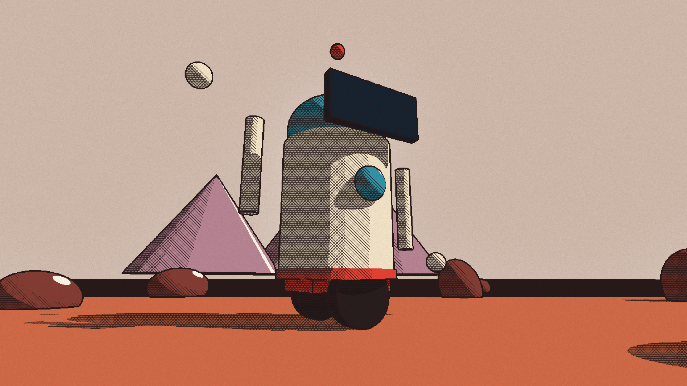
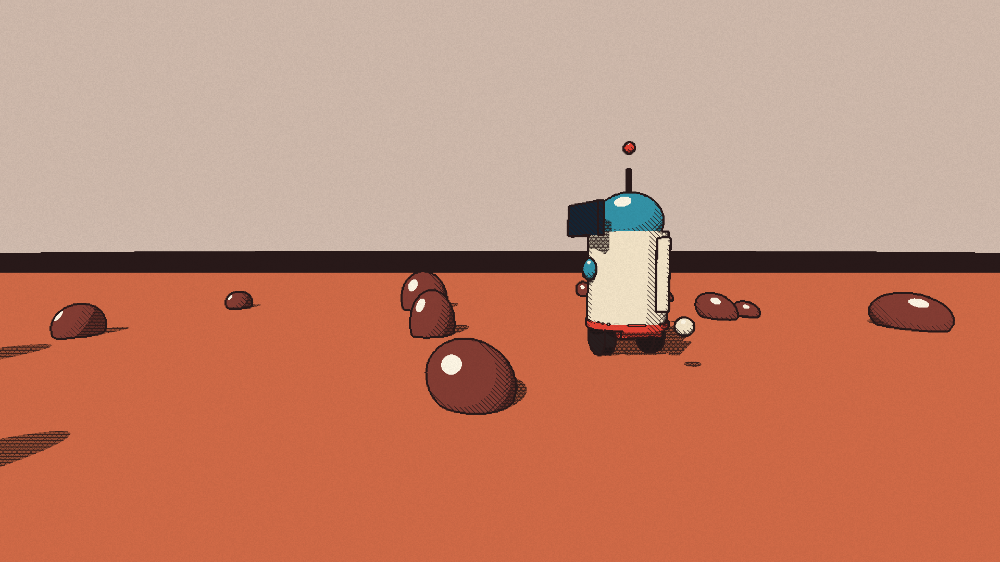
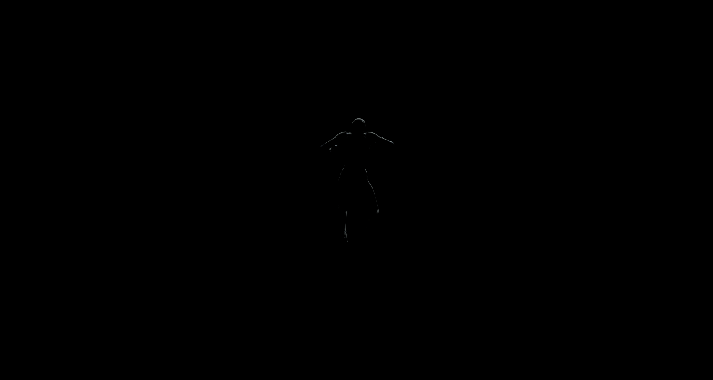
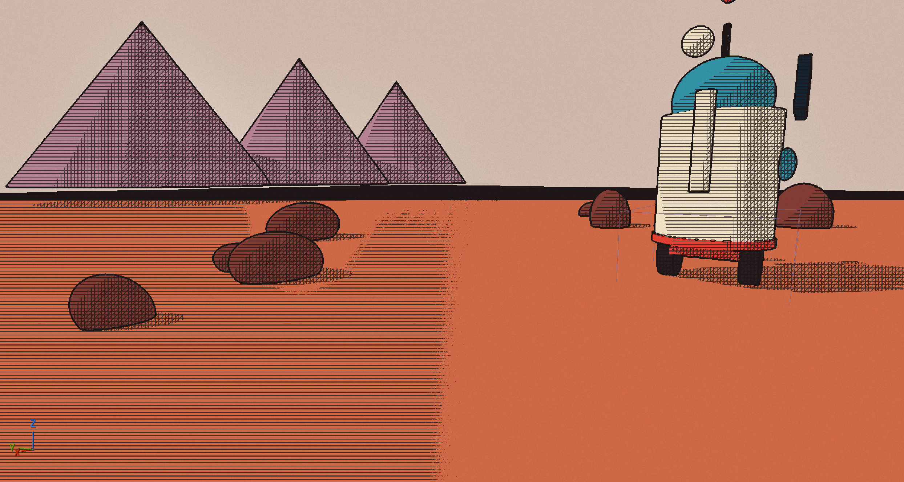

# 0001: A robot on Mars, in a Moebius style

Date: 2026-11-11 to 2026-11-12
Session length: about 6 h, overnight

## Goal

Build a small test scene in Unreal Engine 5.9 (a little robot on Mars) and give
it a hand-drawn, Moebius-inspired comic look: ink outlines, flat colour,
hatching in the shadows, and paper grain. Take pictures to show progress.

## Before and after

| Where we started | Where we ended |
|---|---|
|  |  |

The same scene, rendered by the editor itself:

| close | wide |
|---|---|
|  |  |
| **low** | **side** |
|  |  |

## Steps

1. **Project.** Created `Rovers`, a Third Person C++ project, on UE 5.9 built
   from source on macOS (Apple silicon, Metal). Added its generated folders to
   `.dvignore`.
2. **Research.** Studied a public tutorial on Moebius-style rendering by
   sampling it every 5 s, then wrote down the technique order in our own words.
   The plan is in [`docs/art/moebius-style-spec.md`](https://github.com/AtlantisPleb/SpliceDevLog/blob/main/code/docs/art/moebius-style-spec.md).
   No frames or art from the video are used.
3. **Visual target.** Picked about 40 reference pins. The traits we took from
   them:
   - one dominant hue per picture
   - ink contours over flat colour
   - hatching in shadow
   - chunky robots, mesas, and small figures for scale
4. **Scene.** Built the level entirely from editor Python in
   [`tools/ue/build_scene.py`](https://github.com/AtlantisPleb/SpliceDevLog/blob/main/code/tools/ue/build_scene.py):
   - the robot from basic primitives (wheels, cream body, teal dome, visor,
     antenna, arms)
   - rocks, dunes and three lavender mesas
   - one sun and a sky dome
5. **The look.** One post-process material, built by
   [`tools/ue/postprocess.py`](https://github.com/AtlantisPleb/SpliceDevLog/blob/main/code/tools/ue/postprocess.py). Per pixel, it:
   - reads depth and world normals at four neighbours and draws ink where they
     jump (outlines);
   - replaces lit colour with the surface's flat albedo (flat colour);
   - works out how much the surface faces the sun (N·L) and whether it's in
     shadow, then picks one of four bands;
   - adds one, two or three screen-space hatch layers by band;
   - adds a cream highlight where the surface faces the sun head-on;
   - multiplies a light paper grain over everything.

## What broke

Most of the session went on bugs. Each one is listed below with its cause.

### 1. The scene was nearly black

- **Seen:** a dark viewport, and later a pitch-black one.
- **Cause:** eye adaptation and Lumen, together with very bright or very dim
  light values, while we kept changing several settings at once.
- **Fix:** turned off auto-exposure and Lumen for this look. We now use
  physically small light values (a 3.5 lux sun) at a fixed exposure.

### 2. The player fell through the world, twice

- **Seen:** in play mode, the character dropped into the void.
  
- **Cause, the first time:** the level had no PlayerStart and the ground had no
  collision.
- **Cause, the second time:** the new sky dome, a 200 m sphere, still had
  `BlockAll` collision. The player spawned inside a solid ball and got pushed
  out. Our script had called `set_collision_enabled(NO_COLLISION)`, but that
  doesn't persist on an editor-placed actor.
- **Fix:** `set_collision_profile_name("NoCollision")`. We checked it by
  reading the saved level back.

### 3. The whole effect never drew

- **Seen:** plain engine shading, no matter what the shader did. Even a "return
  pure red" test showed nothing.
- **Cause:** in Unreal Python, `actor.settings` returns a **copy** of the
  post-process settings struct. We had been adding our material to that copy,
  so the volume's real blendables list stayed empty the whole time.
- **Fix:** change the copy, then write it back:
  ```python
  st = volume.settings
  st.set_editor_property("weighted_blendables", arr)
  volume.set_editor_property("settings", st)
  ```
  The effect appeared on the next frame.
  

### 4. The screen was one flat pink

- **Seen:** the viewport showed a single colour.
- **Cause:** `unreal.Rotator(a, b, c)` takes **roll, pitch, yaw** in that order,
  not pitch, yaw, roll. Our camera was looking straight up at the sky dome. The
  sun was aimed wrong for the same reason.
- **Fix:** always pass keyword arguments, for example
  `unreal.Rotator(pitch=-9, yaw=132, roll=0)`.

### 5. The colours were washed out

- **Seen:** coral ground came out pale pink.
- **Cause:** the pass runs after tonemapping, so its output is already display
  colour, and we gamma-encoded the albedo a second time.
- **Fix:** output the albedo as authored.

### 6. Hatching covered sunlit surfaces

- **Seen:** dense lines on the lit robot body and over half the ground (see the
  first-effect frame above).
- **Cause:** we estimated "how lit" from scene colour divided by albedo, which
  drifts with distance and exposure.
- **Fix:** use the spec's method instead. The bands come from N·L against the
  sun, and shadow comes from a low colour ratio.

## Tools and AI

- **Claude Code, an AI coding agent,** did the build work:
  - wrote and ran every editor script
  - read the logs
  - took and checked the screenshots
  - kept this log
- **The fix that changed everything: live editor control.** Unreal 5.9's
  editor runs an MCP server on `127.0.0.1:8000`, with a toolset that runs Python
  inside the open editor.
  - Before, every change meant closing the editor, running a headless script,
    and reopening, about **5 minutes** a round.
  - Through MCP, a change shows up in **2–3 seconds**, while the editor stays
    open. Bugs 3 to 6 were all found and fixed in about 15 minutes after the
    switch.
  - Helper scripts: [`tools/ue/mcp.py`](https://github.com/AtlantisPleb/SpliceDevLog/blob/main/code/tools/ue/mcp.py) and
    [`tools/ue/runpy.sh`](https://github.com/AtlantisPleb/SpliceDevLog/blob/main/code/tools/ue/runpy.sh).
- **Screenshots.** The editor renders them itself with `HighResShot`, through
  [`tools/devlog/shot.sh`](https://github.com/AtlantisPleb/SpliceDevLog/blob/main/code/tools/devlog/shot.sh). A desktop grab often
  caught whatever window was in front instead.

## Numbers

| Measure | Value |
|---|---|
| Iteration loop, headless rebuild and reopen | ~5 min |
| Iteration loop, live through MCP | 2–3 s |
| Scene | 54 actors, all engine primitives |
| Post-process | 1 material, 1 custom HLSL node, 9 scene-texture reads |

## Next

- **Horizon:** a dark band shows where the ground slab meets the sky. Either
  make it a deliberate drawn horizon line or hide the slab edge.
- **Robot:** replace the primitives with a real mesh. The hands and the antenna
  tip currently float.
- **Wobble and highlights:** add the hand-drawn outline wobble, and outlined
  highlight shapes as described in the spec.
- **Grain:** make the paper grain change every 10 frames instead of staying
  fixed.
- **Palette:** tune colours against the reference: a banded sky and stronger
  single-hue dominance.
- **Web:** check that the look works on the mobile renderer for the web build
  (spec milestone M6).
