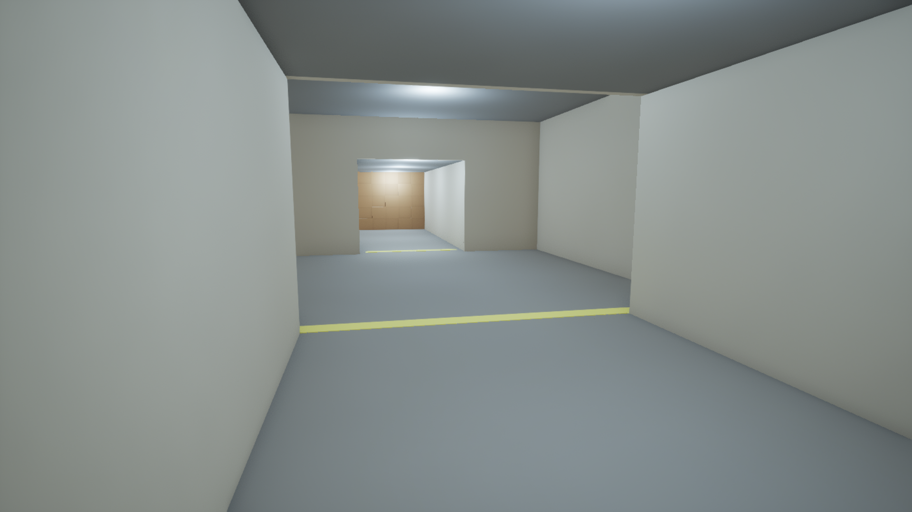
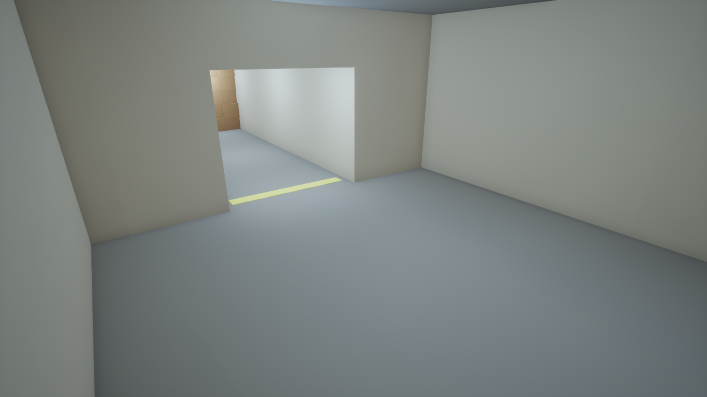
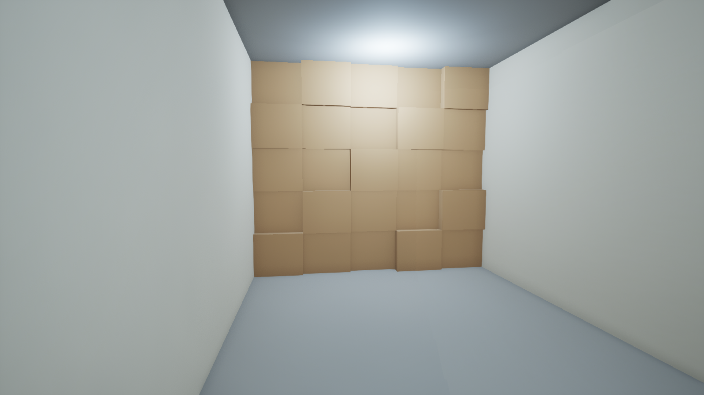
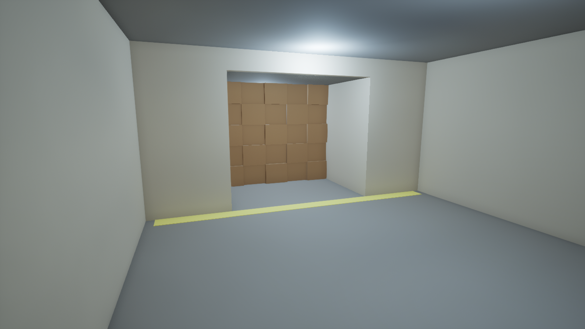

# 0002: Splice gray box, step 1: the mine

Date: 2026-11-12, from about 1:35 AM ET
Session length: about 20 min

## Goal

Start the jam game, **Splice**, from Kiki's pitch and gray box plan. Step 1 is
the level: a straight mine about 40 m long, built from cubes, with four zones in
play order. The test for this step: you can walk from the start to the rubble
wall, and you can't get past it.

## The plan we're following

The loop has three parts:

1. **Scavenge:** pick up robot parts in the mine.
2. **Splice:** in the rover's edit bay, put the hardware into slots and the
   software cards on a film strip, in order.
3. **Deploy:** the restored Digger bot runs its cards. The right order drills
   through the rubble, and a wrong cut glitches.

The plan has seven build steps, each with its own test. We do one step, test
it, and only then go on.

## Result

| Entrance, looking down the mine | Scrap room (10 x 10 m) |
|---|---|
|  |  |
| **Tunnel, blocked by rubble** | **Exit room, looking back at the rubble** |
|  |  |

Layout along +X, with the floor at z = 0:

| Zone | Length | Width | Height |
|---|---|---|---|
| Entrance, with the player start | 8 m | 6 m | 4 m |
| Scrap room | 10 m | 10 m | 5 m |
| Tunnel, with the rubble wall at about 29 m | 14 m | 4 m | 3.5 m |
| Exit room | 8 m | 8 m | 4 m |

- A yellow floor stripe marks the start of each zone.
- The rubble is 25 brown cubes, as a placeholder until `BP_Rubble` arrives in
  step 6.

## Steps

1. Read Kiki's PDF straight from Google Drive, using `gcloud` with Drive access.
2. Wrote [`tools/ue/splice_step1_level.py`](https://github.com/AtlantisPleb/SpliceDevLog/blob/main/code/tools/ue/splice_step1_level.py)
   and ran it inside the open editor through its MCP server. It built 66 actors.
3. **Checked it without playing,** using physics line traces:
   - A walk-height trace from the start hits the rubble at x ≈ 29 m, at every
     height from 0.4 m to 3.3 m.
   - The floors, walls and ceiling all block.
   - From the exit room, a trace back toward the start also hits the rubble, so
     the two sides are sealed from each other.
4. Rendered the four views above with `tools/devlog/shot.sh`.

## What broke

- **Overexposed first render:** the walls came out near white and the rubble
  tan. We dimmed the ceiling lamps from 60 to 22 candela.
- We reused two lessons from entry 0001:
  - **Fixed exposure:** the level uses a fixed exposure from the start, so it
    can't adapt to black.
  - **Settings write-back:** the post-process settings are written back onto
    the volume, not left on a copy.

## Tools and AI

Claude Code built the level, ran the trace test, and took and checked the
renders. Kiki's plan was written as a prompt for exactly this kind of agent.

## Next

- **Human test:** play from the start to the rubble.
- **Step 2:** `BP_Rover` at the entrance, with a "Press E to open Edit Bay"
  prompt.
