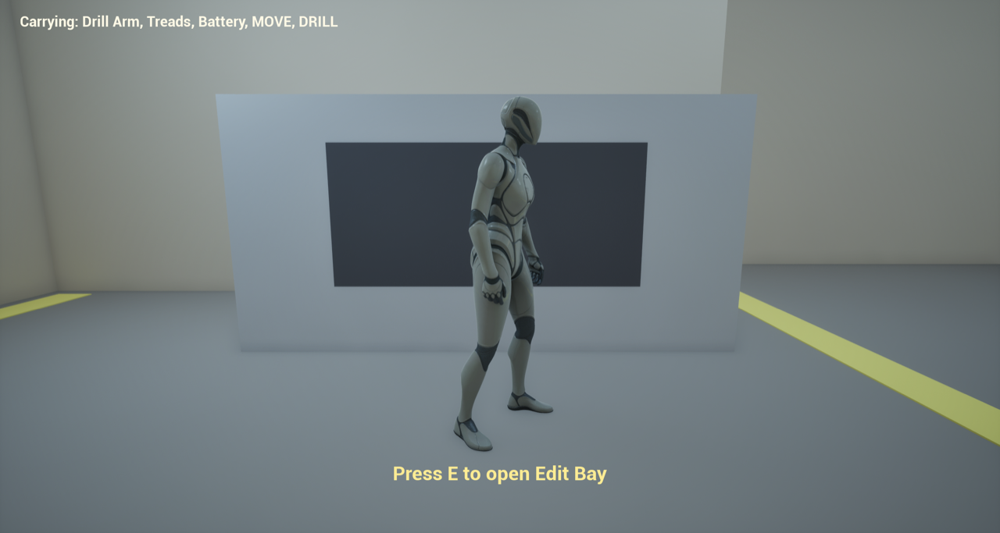
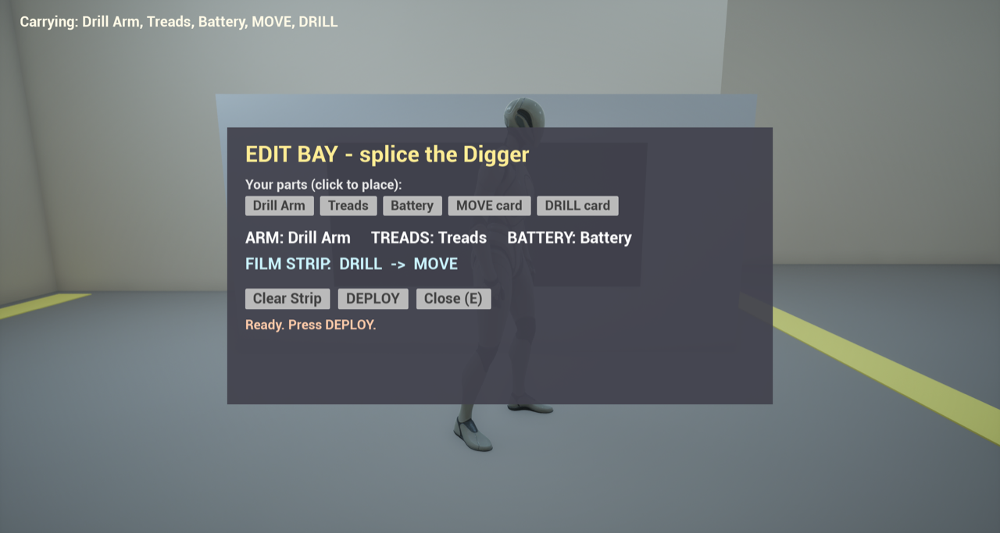
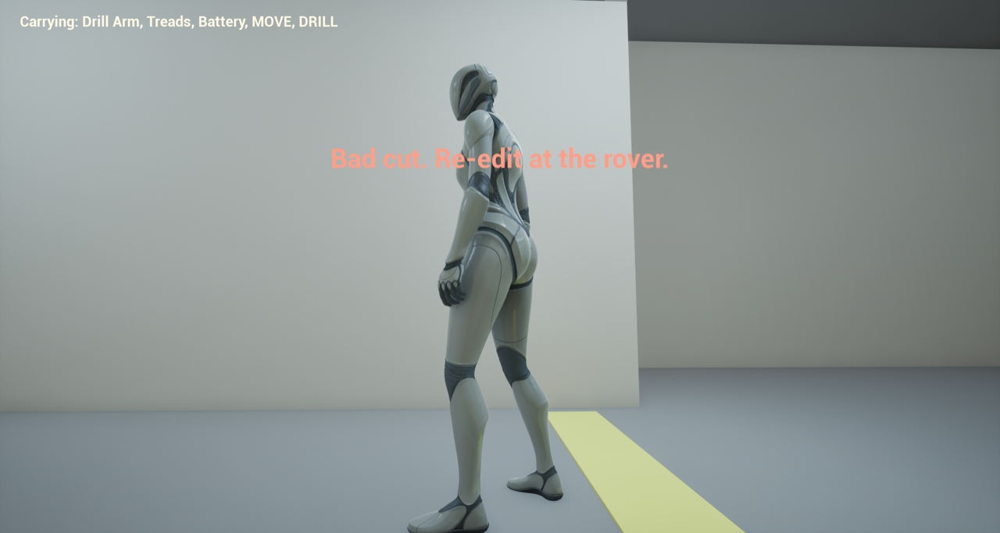
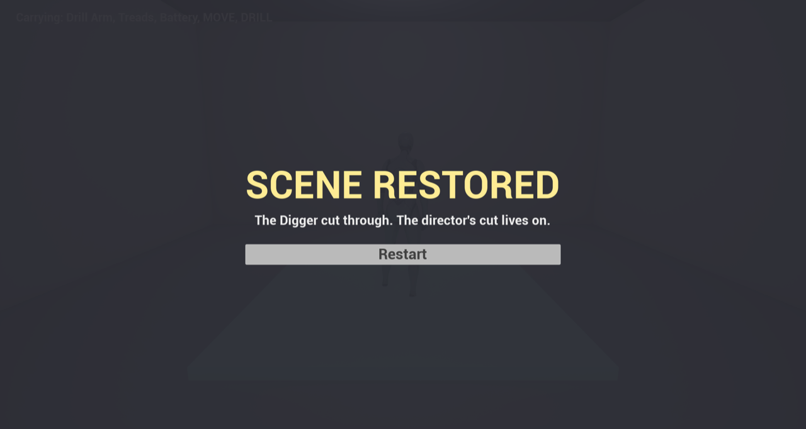

# 0003: Splice gray box, steps 2–7: the full loop

Date: 2026-11-12, from about 1:35 AM ET
Session length: about 1.5 h, run by the agent while the team slept

## Goal

Build the rest of Kiki's gray box plan in one pass:
- the rover;
- the pickups and inventory;
- the edit bay;
- the Digger bot;
- the rubble, with a failure state;
- the end screen.

Everything is in Blueprints, with no C++. The whole loop is tested by script in
play mode.

## Result

| Rover prompt | Edit bay |
|---|---|
|  |  |
| **Wrong cut** | **Scene restored** |
|  |  |

## How it's built

Every graph is written as text in Unreal's Blueprint Graph DSL and applied
through the editor's MCP server. Because the logic is text, it's easy to
review, and every change shows up as a diff.

| Blueprint | Logic | What it does |
|---|---|---|
| `BP_SpliceGame` | [dsl](https://github.com/AtlantisPleb/SpliceDevLog/blob/main/code/tools/ue/splice_dsl/BP_SpliceGame.dsl) | Holds the inventory, the slots and the strip. Runs the HUD, the edit bay and the end screen, and handles the E key |
| `BP_Rover` | [dsl](https://github.com/AtlantisPleb/SpliceDevLog/blob/main/code/tools/ue/splice_dsl/BP_Rover.dsl) | Tells the game when the player is within 4.5 m |
| `BP_Fragment` | [dsl](https://github.com/AtlantisPleb/SpliceDevLog/blob/main/code/tools/ue/splice_dsl/BP_Fragment.dsl) | Walk into it: its item goes into the inventory and the pickup disappears |
| `BP_Bot` | [dsl](https://github.com/AtlantisPleb/SpliceDevLog/blob/main/code/tools/ue/splice_dsl/BP_Bot.dsl) | Runs 2 cards, about 2.4 s apart. MOVE drives up to the rubble; DRILL clears the wall or flashes red and shakes |
| `BP_Rubble` | [dsl](https://github.com/AtlantisPleb/SpliceDevLog/blob/main/code/tools/ue/splice_dsl/BP_Rubble.dsl) | One of the 25 cubes in the rubble wall |
| `BP_EndTrigger` | [dsl](https://github.com/AtlantisPleb/SpliceDevLog/blob/main/code/tools/ue/splice_dsl/BP_EndTrigger.dsl) | Shows SCENE RESTORED when the player walks onto the exit pad |
| `WBP_HUD`, `WBP_EditBay`, `WBP_End` | layout in [splice_build_layout.py](https://github.com/AtlantisPleb/SpliceDevLog/blob/main/code/tools/ue/splice_build_layout.py) | The UI. Buttons are bound to events in `BP_SpliceGame`, so the widgets themselves have no logic |

**Build scripts, in order:**

1. [splice_build_assets.py](https://github.com/AtlantisPleb/SpliceDevLog/blob/main/code/tools/ue/splice_build_assets.py)
2. [splice_build_layout.py](https://github.com/AtlantisPleb/SpliceDevLog/blob/main/code/tools/ue/splice_build_layout.py)
3. [splice_build_vars.py](https://github.com/AtlantisPleb/SpliceDevLog/blob/main/code/tools/ue/splice_build_vars.py)
4. [splice_build_logic.py](https://github.com/AtlantisPleb/SpliceDevLog/blob/main/code/tools/ue/splice_build_logic.py)
5. [splice_place.py](https://github.com/AtlantisPleb/SpliceDevLog/blob/main/code/tools/ue/splice_place.py)

**Playtest:** the script used here was later replaced by a fuller one that plays the
whole run: [splice_playtest_slice.py](https://github.com/AtlantisPleb/SpliceDevLog/blob/main/code/tools/ue/splice_playtest_slice.py)

## Playtest log

These are game-state readouts from the scripted run, in play mode:

```text
[pickups]      inv=[Drill Arm, Treads, Battery, MOVE, DRILL]  fragments=0
[at rover]     near=True   (prompt shows)
[open bay]     arm/treads/battery filled, strip=[DRILL, MOVE]
[deploy wrong] botRunning=True  rubble=25
[wrong result] botRunning=False rubble=25 bots=0   ("Bad cut. Re-edit at the rover.")
[re-cut]       strip=[MOVE, DRILL]
[deploy right] rubble=0
[exit]         end=True   (SCENE RESTORED)
```

## What broke

- **"Could not create Blueprint":**
  - **Cause:** checking whether an asset existed by trying to load it left an
    empty in-memory package behind, and that blocked the create.
  - **Fix:** check the asset registry instead, and create with the asset
    factory.
- **Pins mis-wired by position:**
  - **Cause:** a single unnamed argument fills the first data input, not the
    target object. `AddToViewport`, `bShowMouseCursor` and the bot's
    `Cards` setter all went wrong this way.
  - **Fix:** name every pin.
- **No hit-result break in the graph format:**
  - **Cause:** `HitResult` has a native break function that the format can't
    express.
  - **Fix:** measure the distance on the X axis, since the tunnel is straight.
- **The E key wasn't tested with a real keypress:**
  - **Cause:** macOS blocks scripted keystrokes.
  - **Status:** the same event was tested directly, but a real E press still
    needs one human test.

## Changes from the plan

- **Inventory location:** the plan put it on the player; we put it on the game
  manager, `BP_SpliceGame`. That keeps all the state in one place and leaves
  the template character untouched.
- **Rover detection:** the rover uses a distance check instead of an overlap.

## Next

- **Human test:** play it, including a real E press.
- **Moebius in the mine:** tune it. It assumes an outdoor sun, so the walls are
  over-hatched.
- **Polish:** a GIF of the loop, and fragments that bob so they read as pickups.
