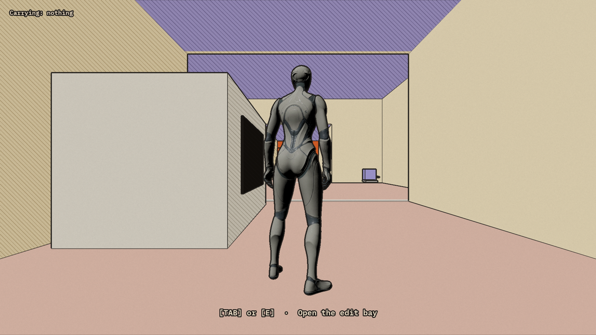
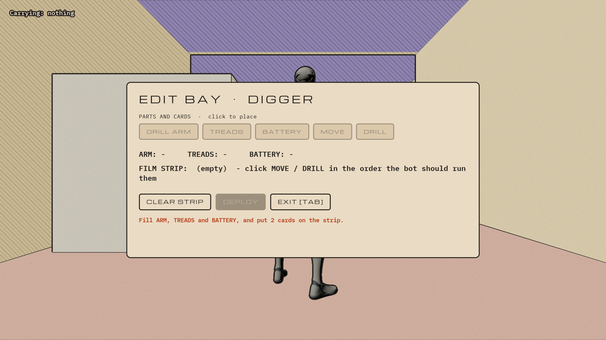
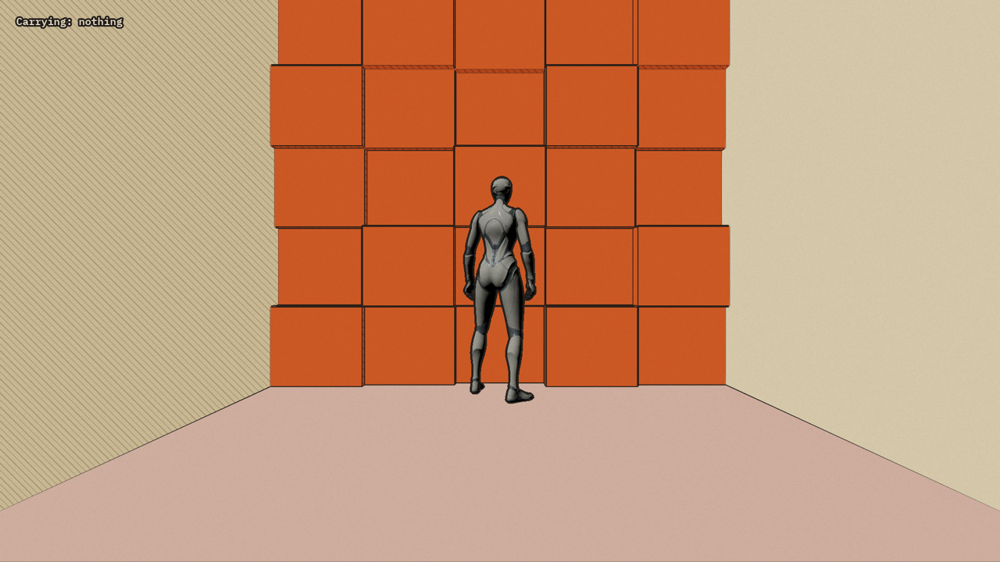
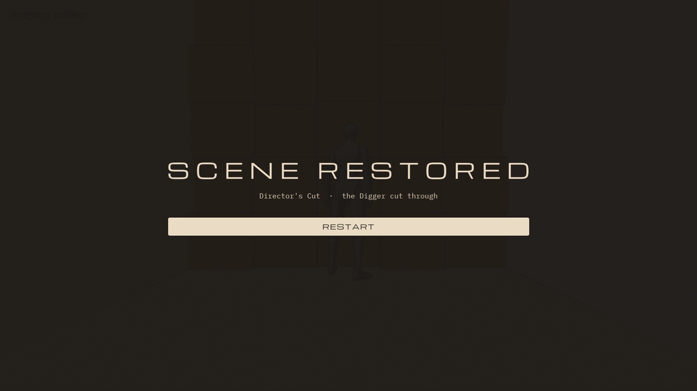
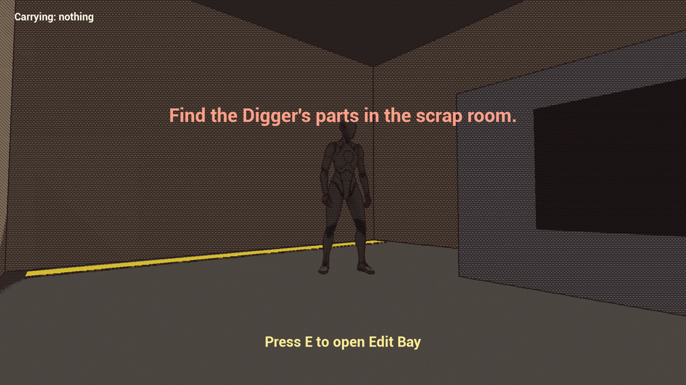
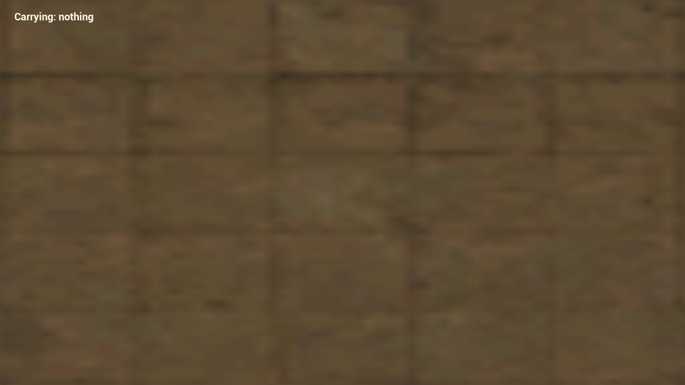
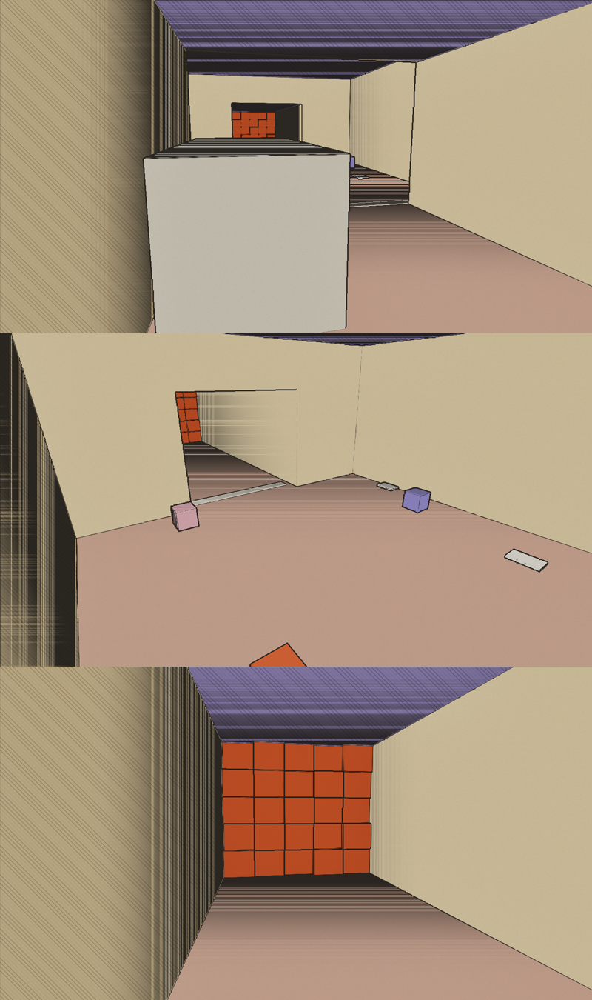

# 0004: First web build, and a look that survives it

Date: 2026-11-12, about 1:00 PM to 2:30 PM ET
Session length: about 1.5 h

## Goal

- Package the gray box for the web and play it in a browser.
- Make the comic look work there.
- Restyle the UI to Kiki's Game UI board.

## Result

The same build, in Chrome, on the **forward** renderer tier (the one phones,
Firefox and low-end GPUs get):

| Start | Edit bay, opened with a real TAB press |
|---|---|
|  |  |
| **The rubble wall** | **End screen** |
|  |  |

## Before

| First web build, deferred tier: heavy hatching everywhere | First web build, forward tier: the 3D view is gone |
|---|---|
|  |  |

## What broke

### 1. The Moebius shader wiped out the 3D view on the forward tier

- **Symptom:** on the forward tier the whole 3D view was one blurry brown
  texture. The UI still worked on top of it.
- **Cause:** the first shader read the normal and base-colour buffers
  (GBuffer). The web's forward tier has no GBuffer, so the material failed to
  compile and the engine swapped in its default material. The cook log said so:
  "GBuffer scene textures not available with forward shading".
- **Fix:** rebuild the look so it needs no GBuffer at all:
  - **World materials are unlit.** Each face gets one flat tone from its
    direction against a fixed "sun". Only shadow-side faces get hatching.
  - **One post-process material, `M_Ink`,** draws the lines from scene depth
    alone.
- **Result:** both tiers now render the same picture, and the look is cheaper
  than before.
- **Script:** [splice_look.py](https://github.com/AtlantisPleb/SpliceDevLog/blob/main/code/tools/ue/splice_look.py)

### 2. Dark streaks across floors and far walls

- **Symptom:** bands of ink on any surface seen at a steep angle.
- **Cause:** the lines come from the second difference of 1/depth, which is
  zero on a flat surface. But the editor renders depth at a lower resolution
  than the screen, so my neighbour samples didn't land evenly, and steep
  surfaces leaked a fraction of their slope into the result.
- **Fix:** only draw a line where the second difference is at least comparable
  to the slope. A real edge passes; the sampling error doesn't.

### 3. Fonts showed as empty boxes

- **Symptom:** every label was a row of boxes after switching to Michroma and
  IBM Plex Mono.
- **Cause:** an imported `.ttf` becomes a Font Face asset, and a widget needs
  a Font asset that wraps it. The structs that fill a Font asset aren't exposed
  to editor Python.
- **Fix:** fill the Font asset with `import_text`, in the same text form the
  engine's own Roboto font exports to.
- **Script:** [splice_build_fonts.py](https://github.com/AtlantisPleb/SpliceDevLog/blob/main/code/tools/ue/splice_build_fonts.py)

### 4. The test camera pointed at the floor

- **Symptom:** in the browser test, the camera looked straight down.
- **Cause:** not the game. The test script clicked the middle of the page to
  give it focus, and the engine read the jump from the corner to the centre as
  a mouse look.
- **Fix:** drop the click; keys reach the game without it.

### 5. The web toolchain wasn't found

- **Symptom:** "Platform Wasm is not a valid platform to build. SDK validation
  failed."
- **Fix:** set `WASM_EMSDK_ROOT` to the emsdk folder before building. It's
  now in [web_build_test.sh](https://github.com/AtlantisPleb/SpliceDevLog/blob/main/code/tools/ue/web_build_test.sh).

## What we built

- **A repeatable web test.** [web_build_test.sh](https://github.com/AtlantisPleb/SpliceDevLog/blob/main/code/tools/ue/web_build_test.sh)
  packages the build, then drives Chrome through both tiers: boot, TAB, E,
  walk for 6 s, end screen, with a screenshot at each step.
- **The UI style pass.** Paper panels with ink borders, Michroma for titles and
  buttons, IBM Plex Mono for labels, as on Kiki's board.
  [splice_build_layout.py](https://github.com/AtlantisPleb/SpliceDevLog/blob/main/code/tools/ue/splice_build_layout.py)
- **TAB opens the edit bay,** as on the board. E still works too.
- **Palette:** sand walls, dusty pink floor, lavender ceiling, burnt orange
  rubble. Blue is kept for banned tech.

## Numbers

| | Deferred tier | Forward tier |
|---|---|---|
| Boot to ready | 3.8 s | 3.5 s |
| WebGPU errors | 0 | 0 |
| Look renders | Yes | Yes (was broken) |
| TAB opens the edit bay | Yes | Yes |

## Tools and AI

- Claude Code drove the editor through its MCP server, packaged the web build
  from the command line, and checked its own browser screenshots through the
  engine's Playwright harness.
- Fonts: Michroma and IBM Plex Mono, both under the SIL Open Font License, from
  Google Fonts.

## Next

- The edit bay is restyled but still has the gray-box layout. The board's
  full-screen editing desk with a film-strip timeline isn't built yet.
- The HUD has no hearts, Heat, phase label or objective panel yet; those come
  with steps 8–10.
- Steps 8–12 of the vertical slice.
