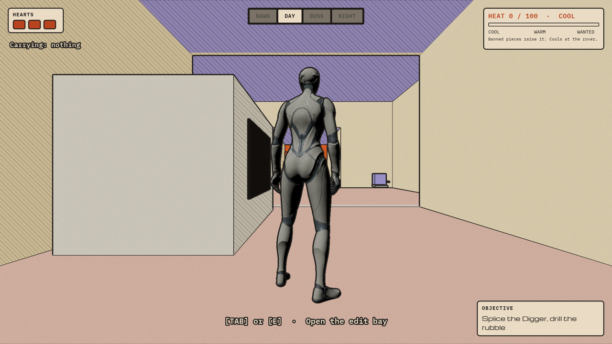
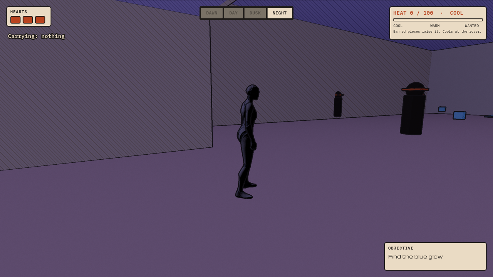
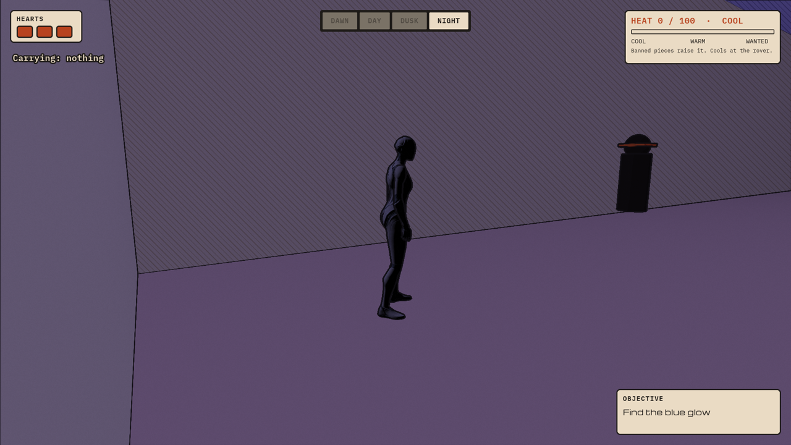
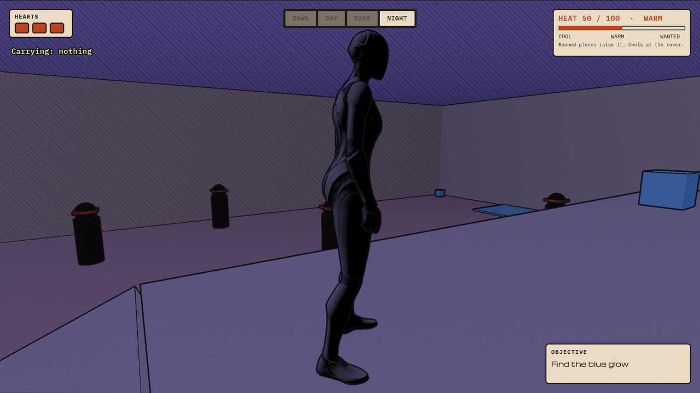
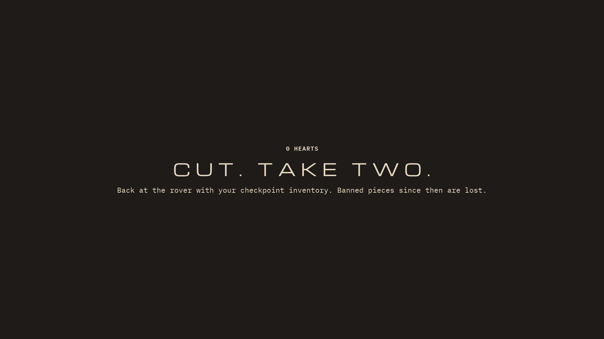
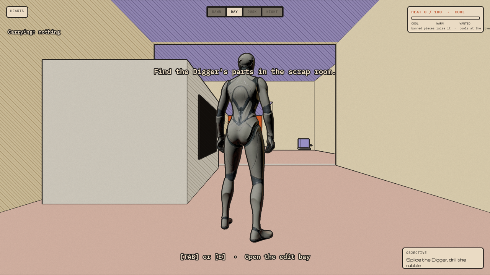

# 0005: Night, Heat, raiders and hearts (slice steps 8–10)

Date: 2026-11-12, about 2:45 PM to 4:15 PM ET
Session length: about 1.5 h

## Goal

Build steps 8–10 of Kiki's vertical slice brief on top of the gray box:

- **Step 8:** day turns to night past the rubble, with an objective panel and a
  phase label.
- **Step 9:** the Party Room, banned pieces, the Heat meter and the Imperial
  Sweep.
- **Step 10:** raiders, hearts and the checkpoint.

Every tuning number goes in one data asset, and the HUD follows her Game UI
board.

## Result

All shots are from the web build in Chrome, on the forward renderer tier.

| Day: the HUD from the board | Night: through the tunnel |
|---|---|
|  |  |
| **The Party Room: raiders and blue banned pieces** | **On the catwalk, Heat at 50** |
|  |  |
| **Out of hearts** | **Max Heat** |
|  |  |

## What we built

| Asset | What it does |
|---|---|
| `BP_Tuning`, `DA_Tuning` | One data asset with every number: Heat per piece, max Heat, cool rate, hearts, raider ranges and speeds, banner time, and the boss numbers for later |
| `BP_TimeOfDay` | Four presets (dawn, day, dusk, night). Each is a tint and a fog colour |
| `MPC_Splice` | Material parameters the presets write to; the ink shader reads them |
| `BP_PhaseTrigger` | An invisible box. Walking through it changes the phase and the objective, once |
| `BP_Raider` | Wanders, notices you up close (further at high Heat), chases, hits for one heart, gives up at 15 m or when you're on the catwalk |
| `BP_Checkpoint` | The glowing post by the rover |
| `BP_Fragment` (changed) | `bIsBanned` pieces raise Heat and hide instead of being destroyed, so they can come back |
| `BP_SpliceGame` (changed) | Heat, hearts, checkpoint save, respawn, phase and objective |
| `WBP_HUD` (changed) | Hearts, phase chips, Heat meter and objective panel |
| `WBP_Sweep`, `WBP_TakeTwo` | The two full-screen banners |
| Party Room | 30 × 20 m, a catwalk 3 m up along one wall, a ramp at each end |

**Scripts:**

- [splice_slice_assets.py](https://github.com/AtlantisPleb/SpliceDevLog/blob/main/code/tools/ue/splice_slice_assets.py)
- [splice_slice_level.py](https://github.com/AtlantisPleb/SpliceDevLog/blob/main/code/tools/ue/splice_slice_level.py)
- logic in [splice_dsl/](https://github.com/AtlantisPleb/SpliceDevLog/blob/main/code/tools/ue/splice_dsl)

**How night works.** The world is unlit, so there is no sun to move. Each
preset is a tint and a fog colour applied in the ink post-process. Pixels
where blue dominates keep their colour, so banned tech glows at night for
free.

## Scripted playthrough: 23 checks, all pass

[splice_playtest_slice.py](https://github.com/AtlantisPleb/SpliceDevLog/blob/main/code/tools/ue/splice_playtest_slice.py) plays it in the
editor and checks the game's state at each step:

```text
[start]            3 hearts, Heat 0, phase Day, 5 raiders, none chasing
[gray box run]     MOVE then DRILL clears the rubble; objective moves on
[night switch]     phase Night; objective "Find the blue glow"
[catwalk piece]    Heat 25; no raider chases; no heart lost
[floor piece]      Heat 50; raiders chase
[raider hits]      one hit costs exactly one heart
[out of hearts]    back at the checkpoint; 3 hearts; Heat 0; lost pieces back in the level; parts kept
[heat cools]       Heat falls about 5 per second at the rover
[imperial sweep]   banner shows; sent back; Heat reset
[end pad]          end screen shows
```

## What broke

### 1. Three hearts gone in under three seconds

- **Symptom:** the first playthrough lost all three hearts almost at once.
- **Cause:** each raider had its own 1-second cooldown, and several arrived
  together.
- **Fix:** the player, not the raider, holds the cooldown. After any hit the
  player can't be hit again for `RaiderHitCooldown` seconds.

### 2. A lost banned piece was picked straight back up

- **Symptom:** after running out of hearts, the player came back carrying one
  banned piece instead of none.
- **Cause:** on respawn the lost pieces reappeared before the player was
  moved, and one reappeared right under the player's feet.
- **Fix:** move the player to the checkpoint first, then bring the pieces back.

### 3. The hearts didn't draw



- **Symptom:** the HEARTS panel showed its label and nothing else.
- **Cause:** each heart is a box sized by a Size Box. Setting the width
  property from Python doesn't switch the override on, so the size stayed zero.
- **Fix:** call `set_width_override` and `set_height_override`, which do
  both.

### 4. The game actor and the rubble wall vanished from the level

- **Symptom:** partway through, the level had no game-state actor and no
  rubble.
- **Cause:** not found. The editor log has nothing on it.
- **What we did:** the level scripts now recreate both when they're missing.
  This also fixed a real bug: re-running the placement script used to delete
  the rubble with no way to rebuild it.

### 5. The editor refused tool calls for a moment

- **Symptom:** "the Unreal Editor is running a slow task, which blocks editor
  tools."
- **Fix:** the helper now waits and retries.

### 6. Three wrong names in the Blueprint text format

- `Float` isn't a pin type; `"Float (double-precision)"` is.
- `"Linear Color Structure"` should be `"LinearColor Structure"`.
- `VInterpConstantTo` is really `VInterpTo_Constant`.

The editor's own lookup tool gave the right names each time.

## What we changed from the brief

- **Sun angle and sky colour:** the brief's presets list sun angle, sky colour
  and fog colour. The world is unlit and indoors, so the presets are a tint and
  a fog colour instead.
- **Checkpoint:** reaching the rover saves, since the checkpoint post stands
  next to it.
- **Max Heat with three pieces:** three banned pieces at +25 reach 75, not 100.
  The sweep only triggers once a lost piece has been picked up again. The
  numbers are in `DA_Tuning` for Saturday's balancing.
- **Still hard-coded:** the gray box's own numbers (rover range, the Digger's
  timings) are not in `DA_Tuning` yet.

## Next

- Steps 11–12: the stash crate, DRILL+, the boss, and the memory ending.
- The edit bay's full-screen layout from the board.
