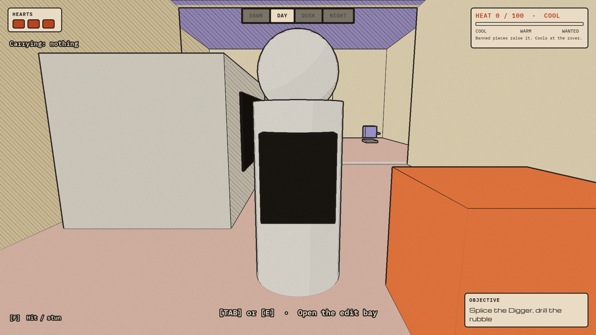
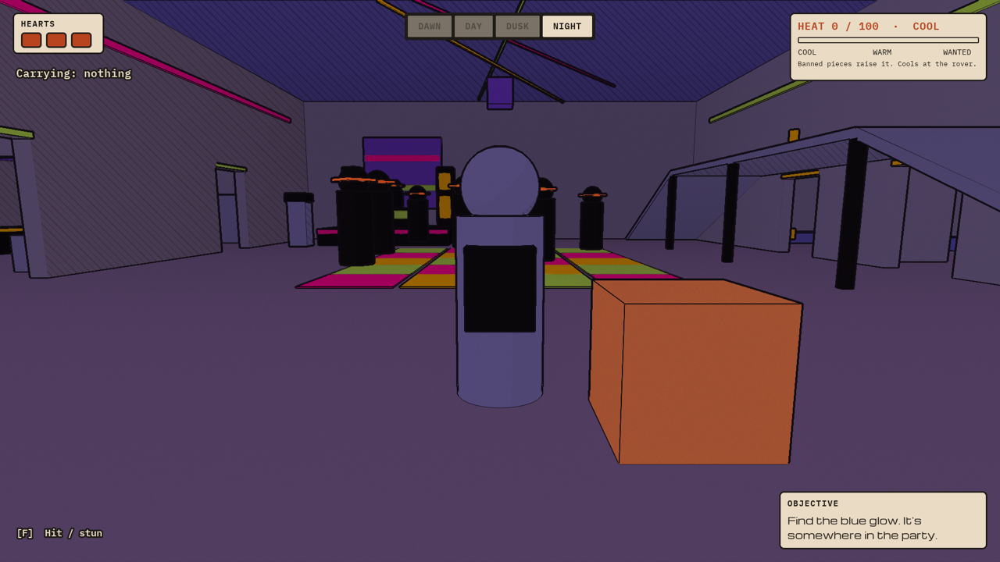
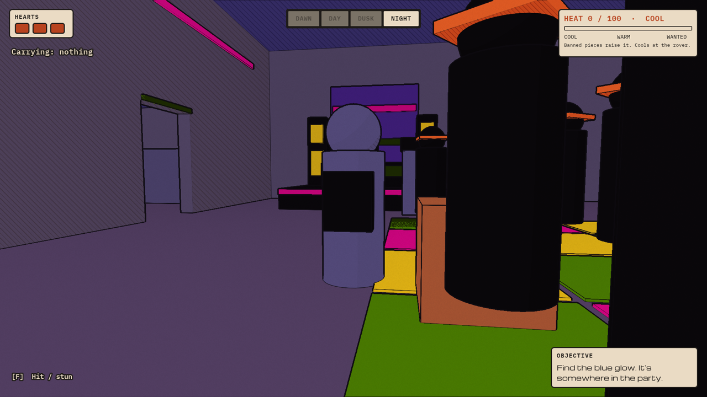
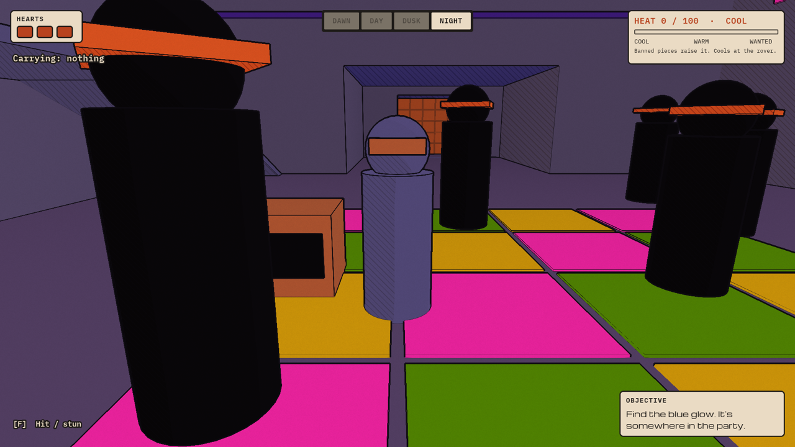
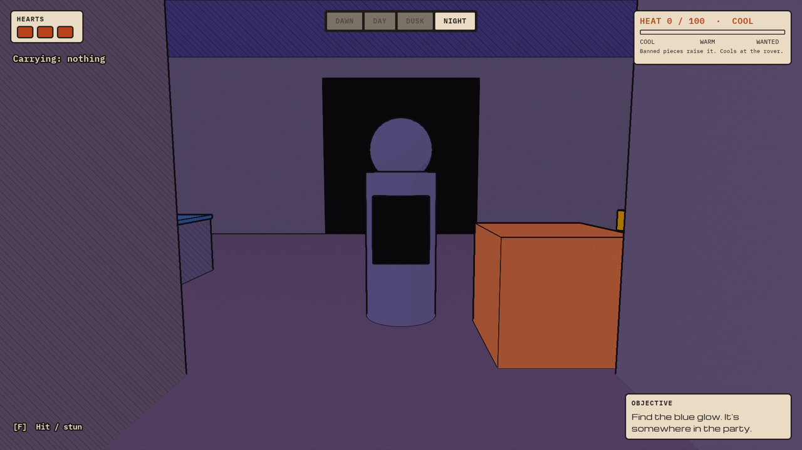
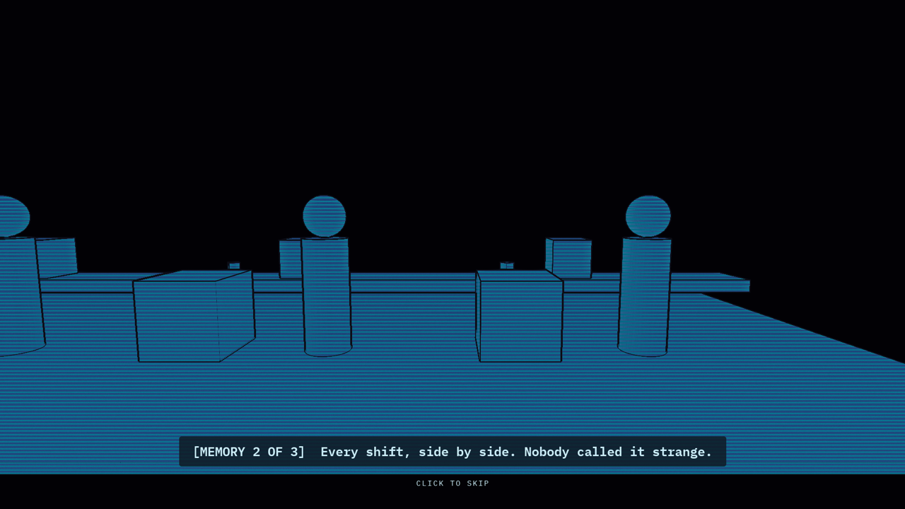
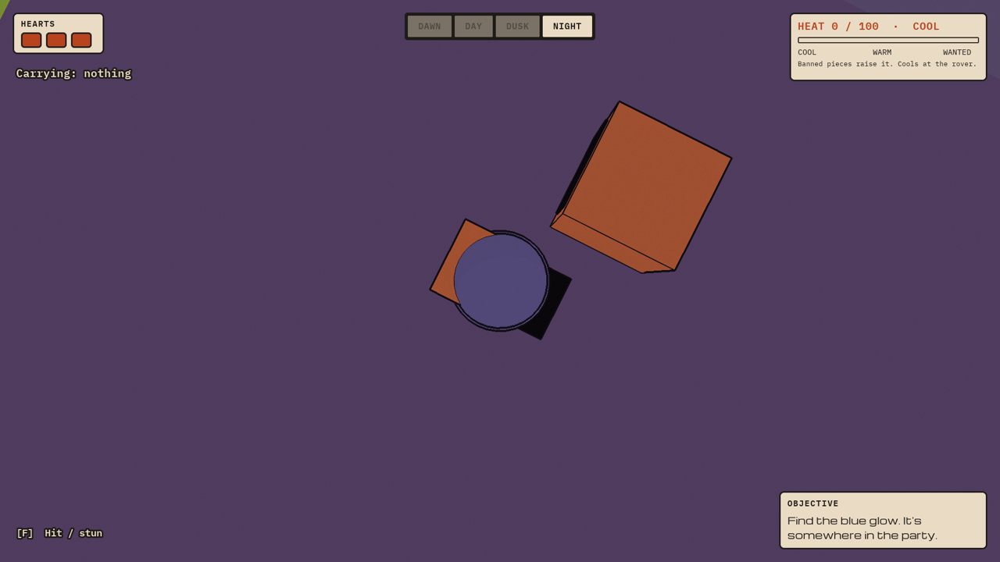

# 0006: The party, the Digger at your side, the boss and the ending

Date: 2026-11-12, about 4:45 PM to 7:00 PM ET
Session length: about 2.25 h

## Goal

Two things at once:

- **Finish Tier 1 of the brief** (steps 11–12): the stash crate, DRILL+, the
  boss wall, the boss, the core and the memory ending.
- **Rework the night zone** after playing it. Chris's notes:
  - a network of rooms to explore for *one* blue piece, not several;
  - a cyberpunk party with a DJ and a main stage;
  - raiders who dance and leave you alone;
  - Imperial robots on patrol;
  - fights that drop robot parts;
  - battery cells to find;
  - the Digger always at your side;
  - a cylinder for the player.

## Result

The whole run is now playable from the first pickup to SCENE RESTORED. All
shots are from the web build in Chrome, on the forward renderer tier.

| Day: the cylinder player and the Digger | Night: the main hall |
|---|---|
|  |  |
| **The stage** | **On the dance floor** |
|  |  |
| **The vault: the boss wall ahead** | **The memory** |
|  |  |

## What changed in the design

| Before | Now |
|---|---|
| One Party Room | Eight rooms: main hall, bar, lounge, storage, workshop, corridor, vault, boss chamber |
| Three banned pieces | One blue piece: the DRILL+ part, at one of three spots chosen at random each run |
| Raiders chase on sight | Raiders dance in place and only fight back if you hit them |
| No Imperial robots (cut in the brief) | Three Imperial robots patrol. They ignore a player whose Heat is cool and hunt a hot one |
| No fighting | F hits whoever is in reach. A beaten raider or robot adds a robot part to the inventory, and winning raises Heat |
| Nothing to find in side rooms | Eight battery cells across the rooms |
| The Digger appears in the tunnel on DEPLOY | The Digger wakes when its three parts are spliced, follows you everywhere, and drives from your side to the job when deployed |
| Template mannequin | A cylinder with a head, an orange visor and a pack |

## What we built

| Asset | What it does |
|---|---|
| `BP_Bot` (reworked) | Follow mode, travel mode and work mode. Runs up to 3 cards. DRILL+ breaks the boss wall; plain DRILL can't |
| `BP_Raider`, `BP_Imperial` | One shared logic file. Raiders dance; Imperial robots walk a route and hunt by Heat. Both can be hit, stunned and beaten |
| `BP_StashCrate` | The edit bay opens here too, and Heat cools near it |
| `BP_BossWall` | Only DRILL+ breaks it |
| `BP_Boss` | Wakes when its wall is down. Its arm glows red, then sweeps for one heart. Three weak points to stun with F |
| `BP_BannedCore` | Dropped when the boss powers down |
| `BP_Spinner` | Set dressing that spins or bobs: the light bars, the mirror cube, the memory's bots |
| `BP_MemoryCam`, `M_Hologram`, `WBP_Memory` | The memory scene: a camera dolly across a hologram diorama, three captions, click to skip |
| Four neon materials | Pulsing party colours. No blue: blue stays reserved for banned tech |
| `DA_Tuning` | Now 35 numbers, including the Digger's and the rover's that used to be hard-coded |
| The player | The template character's mannequin is hidden; a cylinder body, head, visor and pack are added |

**Scripts:**

- [splice_slice_assets.py](https://github.com/AtlantisPleb/SpliceDevLog/blob/main/code/tools/ue/splice_slice_assets.py)
- [splice_slice_level.py](https://github.com/AtlantisPleb/SpliceDevLog/blob/main/code/tools/ue/splice_slice_level.py)
- logic in [splice_dsl/](https://github.com/AtlantisPleb/SpliceDevLog/blob/main/code/tools/ue/splice_dsl)

**How neon glows at night.** Night is a tint over the whole picture. The ink
shader leaves strongly saturated, bright pixels untinted, so neon, the heat-
orange bands and banned-tech blue all stand out against the dark for free.

**The memory without Sequencer.** The brief asks for a Level Sequence. We
drive the scene from Blueprints instead: the view cuts to a camera actor that
dollies by itself, and the game shows three captions on a timer. It's simpler
and avoids a web risk the brief itself flagged.

## Scripted playthrough: 46 checks, all pass

[splice_playtest_slice.py](https://github.com/AtlantisPleb/SpliceDevLog/blob/main/code/tools/ue/splice_playtest_slice.py) plays the whole run
in the editor:

```text
[start]               3 hearts, Day, no Digger, 12 raiders, 3 Imperial robots
[splice the Digger]   5 parts; the Digger wakes when its 3 parts are placed
[wrong cut]           the Digger drives to the job; DRILL then MOVE leaves the rubble; it comes back
[right cut]           MOVE then DRILL clears the rubble
[the Digger follows]  beside the player after a long move
[night switch]        phase Night; objective "Find the blue glow"
[raiders are passive] standing next to one: nobody chases, no heart lost
[fight a raider]      first hit provokes exactly one; two hits beat it; +1 robot part; Heat +15
[find the blue piece] at one of its 3 spots; DRILL+ in the inventory; Heat +25
[battery cell]        picked up
[Imperial robot]      at Heat 40 a nearby robot gives chase
[catwalk is safe]     nobody chases a player up there
[out of hearts]       banner; checkpoint; DRILL+ lost and back in the level
[reach the crate]     DRILL+ again; the Digger followed all the way
[plain DRILL]         the boss wall stays; Heat cools at the crate
[DRILL+]              the wall is gone
[boss]                wakes; three stuns power it down
[core]                in the inventory
[memory]              the camera cuts to the memory scene; overlay up
[ending]              after three captions, SCENE RESTORED
```

## What broke

### 1. F hit everyone in reach

- **Symptom:** one press beat two raiders standing close together.
- **Cause:** the hit sat inside a loop over all raiders with a "return" after
  it. In a Blueprint loop, "return" only ends that pass; the loop carries on.
- **Fix:** a flag set on the first hit; later passes check it.

### 2. The browser test's camera looked at the floor



- **Symptom:** every night screenshot looked straight down.
- **Cause:** the game page captures the mouse. The test runs in a hidden
  browser on the same machine we were working on, so our real mouse movements
  turned its camera.
- **Fix:** a test-only `DebugLook` event. The test aims the camera itself
  just before each shot.

### 3. A level script overwrote itself with the old version

- **Symptom:** after "rebuilding" the night zone, the level still had the old
  single Party Room.
- **Cause:** the file tool refused to save the new script because the file had
  changed on disk since it was last read, and the old script ran instead.
- **Fix:** re-read, save, run again, and check the script's own summary line
  (it now reports the room count) instead of trusting the exit code.

### 4. Re-running placement would have brought the old end pad back

- **Fix:** the placement script no longer spawns it. The run ends with the
  memory scene now.

## Departures from the brief, to confirm with Kiki

- **Imperial robots** were on the brief's cut list. They are back, as patrols.
- **One banned piece, not three.** It is the DRILL+ part itself.
- **Raiders are passive** until hit.
- **Heat** now also rises when you win a fight (+15).
- **The memory** is Blueprint-driven, not a Level Sequence, and has no fade in
  or out yet.
- **Robot parts and battery cells** are counted but do nothing yet. They are
  there to be sold for battery juice later.

## Known rough edges

- Chasing characters walk in a straight line, so they can pass through walls.
- The Digger has no collision and can clip through walls when it follows.
- There is no sound yet; the party is silent until Kiki's sound drop.
- The edit bay still has the old layout.

## Next

- Tier 2: the village, the rail drive and the title screen.
- Swap in Kiki's Drop 1 assets on Friday morning.
