# 0007: A faster prototype, and a bridge that plays it inside Unreal

Date: 2026-11-12, about 8:20 PM to 11:40 PM ET
Session length: about 3.3 h

## Goal

Two things, and the second one changed how we build the rest of the jam:

- **Make the Unreal build look like the game we want.** Build note 0006 left
  us with a full Tier 1 run in sealed gray rooms. The art direction is open
  desert, canyon walls and a neon party.
- **Stop building the game twice.** During the day we also prototyped the same
  design in the browser with our own OpenAgents tools. The prototype got ahead
  of the Unreal build. We wanted that work inside Unreal, not beside it.

## Result

The whole run, from the title screen to SCENE RESTORED, now plays inside
Unreal Engine 5.9: in the editor, and in Unreal's web build in Chrome.

| The prototype (our OpenAgents tools, in the browser) | The same moment in Unreal |
|---|---|
| 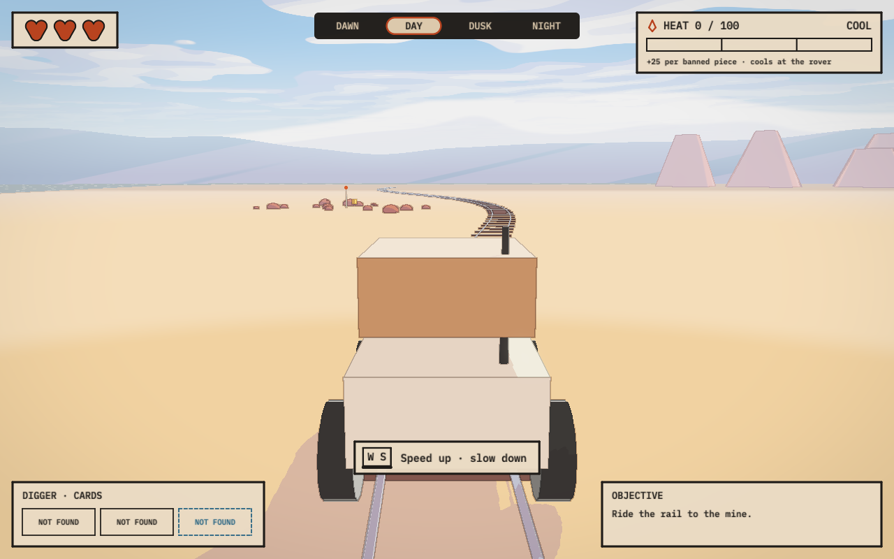 | 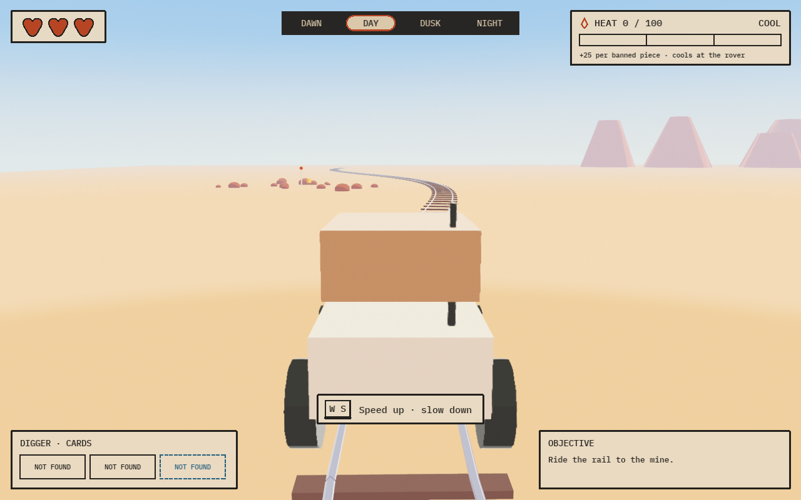 |
| 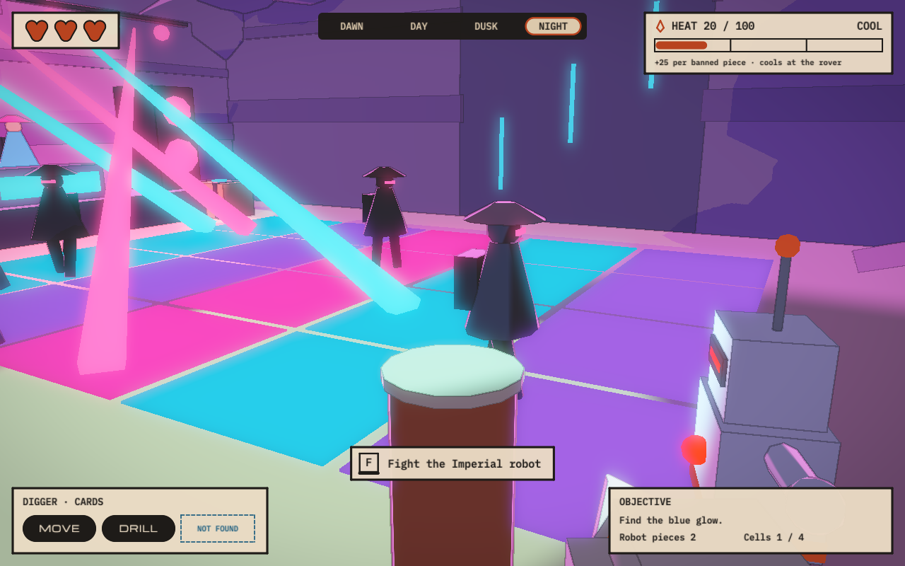 | 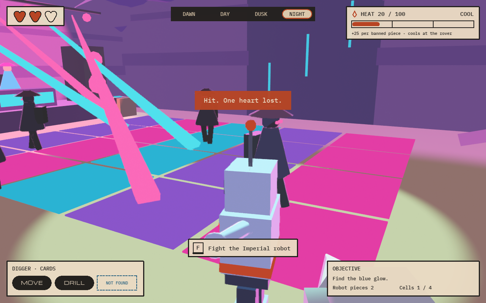 |

The differences you can see are real and listed under "Known rough edges": the
Unreal side has no clouds, no cast shadows and no glow yet.

More from Unreal:

| The edit bay | The boss |
|---|---|
| 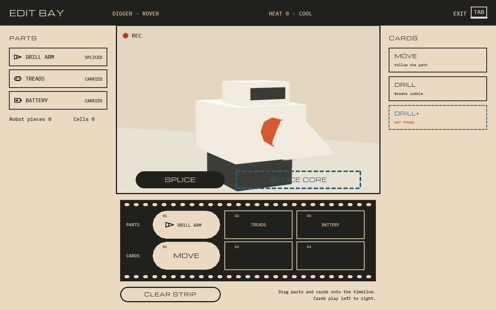 | 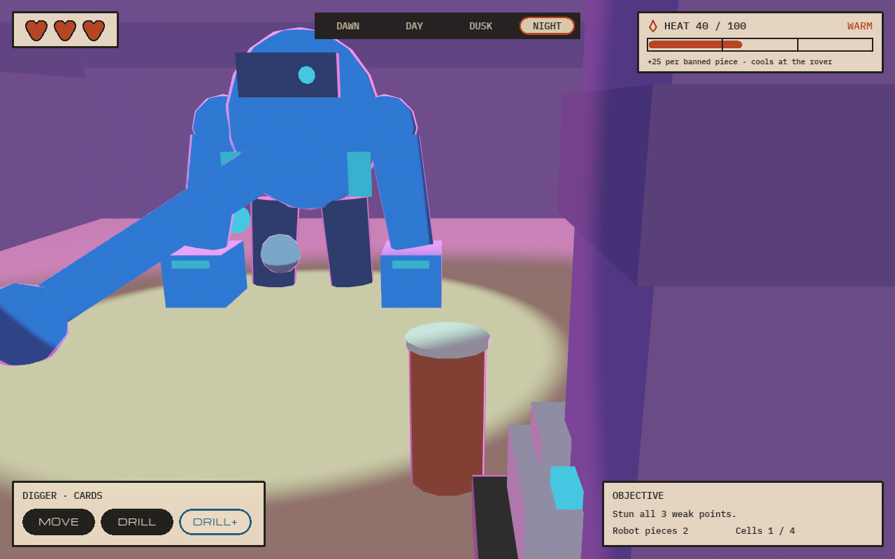 |
| **Unreal's web build: the title** | **Unreal's web build: the mine** |
| 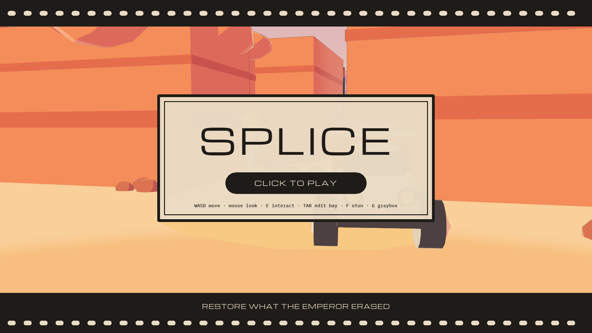 | 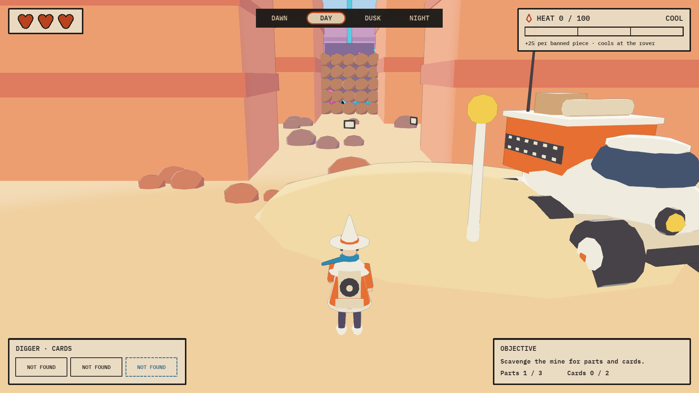 |
| **Unreal's web build: the party** | **Unreal's web build: graybox mode (G)** |
| 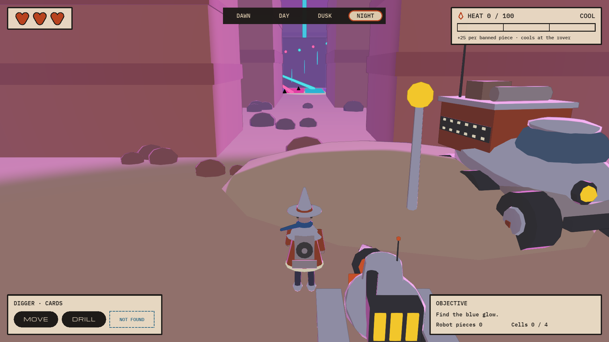 | 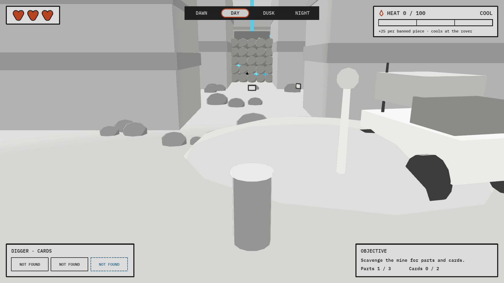 |

## Why we had two versions

While the Unreal build went through Tier 1, Chris asked a second agent for its
own take on the same design document, using prototyping tools we build at
OpenAgents. They draw in the browser and rebuild in about 8 seconds.

By the evening the prototype had things the Unreal build didn't:

- the open desert, canyon mine and mesas;
- the title screen, the dome village with its scanner gate, and the rail ride
  (all of Tier 2 in Kiki's brief);
- characters and vehicles made of parts, not single cylinders;
- coloured light pooling on the party floor.

We compared the two builds side by side and wrote down why they differed. The
short version:

| Cause | Prototype | Unreal build |
|---|---|---|
| Where it started | From pictures: 17 staged still scenes before any rule existed | From the gray box checklist; the look came later |
| Time to see a change | About 8 s | About 10 minutes for a web build |
| Lighting | Soft cel shading with coloured light | We had thrown lighting away to make the first shader run on the web's forward tier |
| The world | Open desert | Sealed rooms with a ceiling |
| Design changes | One file holds layout, rules and drawing | Spread over Blueprints, generator scripts and a level |

None of that is Unreal's fault. It's how we used it. The fast loop let the
prototype try more pictures in a day.

## Steps

### Part 1: rebuild the Unreal project by hand (8:20 PM to 8:46 PM)

Our first answer was to rebuild the `Rovers` project to match the prototype.

1. 8:20 PM: wrote the gap list: 7 look gaps, 9 world gaps, plus characters,
   camera and flow.
2. 8:25 PM: generated six kit meshes in script and imported them: mesa, cloak,
   hat, drill, rock and dune
   ([splice_meshes.py](https://github.com/AtlantisPleb/SpliceDevLog/blob/main/code/tools/ue/splice_meshes.py)).
3. 8:30 PM: rewrote the look
   ([splice_look.py](https://github.com/AtlantisPleb/SpliceDevLog/blob/main/code/tools/ue/splice_look.py)):
   cel shading with coloured light pools, glow, a sky, and thinner ink lines.
4. 8:37 PM: rebuilt the player, raider, Imperial robot, Digger, boss and rover
   from part lists
   ([splice_kits.py](https://github.com/AtlantisPleb/SpliceDevLog/blob/main/code/tools/ue/splice_kits.py)).
5. 8:40 PM: rebuilt the world outdoors at the prototype's coordinates: canyon
   mine, party rooms, boss chamber, village and rail line. 666 pieces
   ([splice_world.py](https://github.com/AtlantisPleb/SpliceDevLog/blob/main/code/tools/ue/splice_world.py)).

| Build note 0006: the party in sealed rooms | Rebuilt in the editor |
|---|---|
| 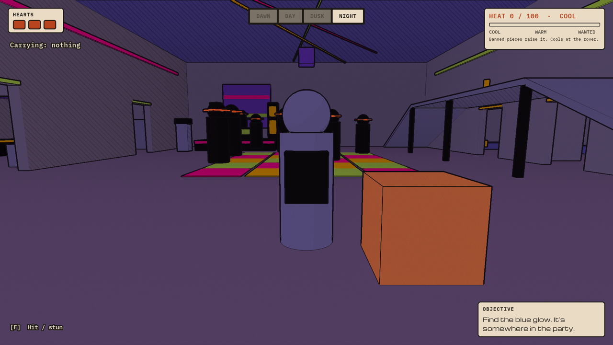 | 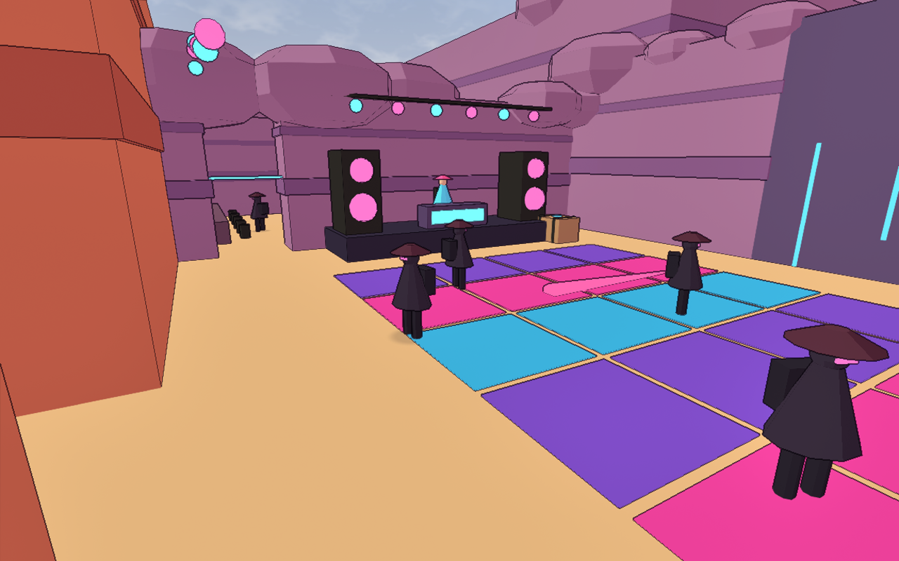 |
| **The mine mouth and the rover** | **The boss** |
| 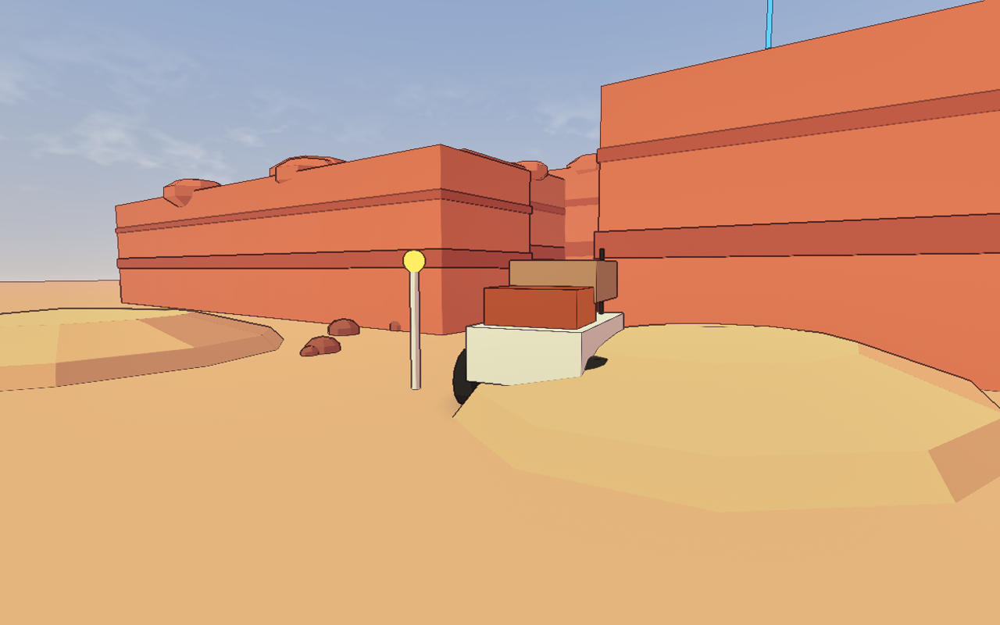 | 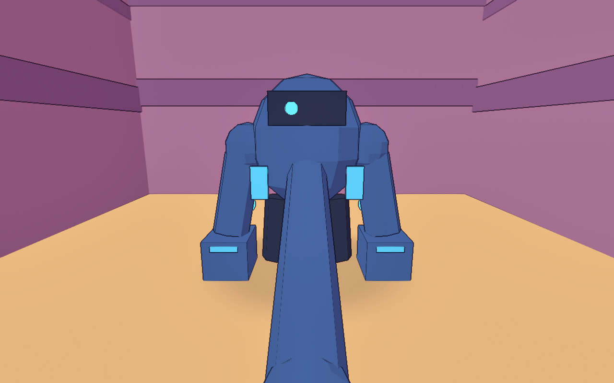 |

The look and the world came across in under half an hour. The game logic did
not. Every rule (the Digger's cards, Heat, the boss, the new title, village and
rail flow) still had to be rewritten as Blueprints for the new layout, and
then rewritten again each time the prototype changed. Until that lands, the
rebuilt `Rovers` level is a world you can look at but not play.

### Part 2: decide to bridge (9:17 PM)

Copying by hand means every design change is made twice, and the second copy is
always behind. So we changed the plan:

- **Prototype in our OpenAgents tools.** That's where the fast loop is.
- **Export to Unreal.** Unreal is where the game ships, and where Kiki's models
  and sound go in.

The design of the bridge is one sentence: **move the content, host the rules.**

| What | How it gets into Unreal |
|---|---|
| The static world | Exported as a glTF file and imported as static meshes |
| Collision, spawn points, tuning numbers | A manifest file; the importer makes Unreal actors and a data asset from it |
| The rules of the game | The prototype's rules compile to plain C. An Unreal plugin compiles that C and calls it once a frame |
| Moving things (player, raiders, Digger, boss) | Drawn each frame from the rules' output, or swapped for Unreal models by a designer |
| HUD and edit bay | Drawn by an Unreal HUD class from the rules' output, with the real fonts |
| The look | Unreal materials driven by a Material Parameter Collection |

We wrote this as a specification with four steps. Each step ends on a check
that a script runs, never on a claim.

### Part 3: build it (9:25 PM to 11:34 PM)

**Step 0 (9:25 PM to 9:38 PM): prove the two risks.**

- *Will the rules' C code run inside Unreal, including Unreal's 64-bit web
  build?* We ran a fixed 34-frame script and hashed everything a host reads.

  | Build of the rules | Result |
  |---|---|
  | The browser prototype (32-bit Wasm) | Reference |
  | Native Mac | Byte-identical |
  | 64-bit Wasm with Unreal's own Emscripten | Byte-identical |
  | Inside an Unreal 5.9 editor module | Same hashes |
  | Inside a packaged Unreal 5.9 web build, in Chrome | Same hashes |

- *Which way do the axes go?* We exported three marker cubes and read where
  they landed. Unreal X is our x, Unreal Y is our z, Unreal Z is our y, times
  100.

**Step 1 (9:43 PM to 10:15 PM): the static world.**

- The exporter writes the world as 59 meshes and 24,242 triangles, grouped by
  material and by 64 m cell.
- A Python importer builds an Unreal level from it: mesh actors, 30 collision
  boxes, 50 markers and a tuning asset with 49 numbers.
- The importer then checks its own work: every vertex position and colour
  against the export to within 1 mm, and six camera shots against reference
  pictures.

**Step 2 (10:15 PM to 10:37 PM): the rules, the look and the interface.**

- The plugin hosts the rules and feeds them Unreal's keyboard and mouse.
- A scripted run plays the whole game inside Unreal, title to SCENE RESTORED,
  and prints a hash at 11 points. All 11 match the prototype's.
- The same run passes in Unreal's web build, on both renderer tiers.

**Step 3 (10:37 PM to 10:57 PM): hand the pieces to Unreal.**

- The moving things are also exported as 20 Unreal static meshes. Unreal
  can draw them itself, and the picture differs from the first way by less than
  1 part in 255.
- A designer can swap any of them in a Data Table that the importer never
  rewrites. To test it, a stand-in designer script swapped the raider for a
  cone and added a sound to the pickup event:

  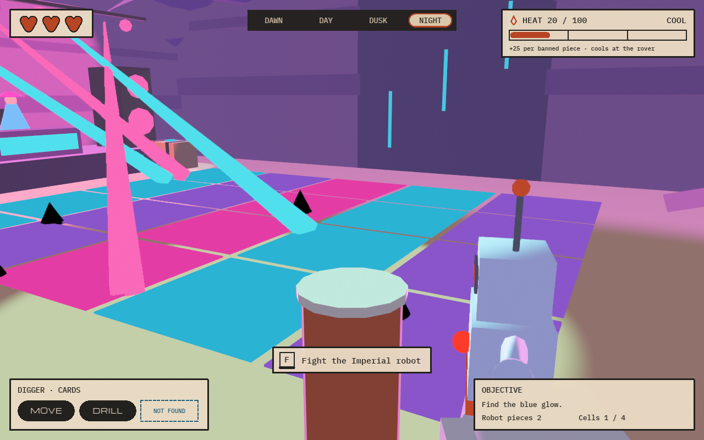

  The raiders are cones, the run still passes, and the sound event fires six
  times, once per pickup. This is the door Kiki's models and sound come in
  through.

11:35 PM: opened Unreal's web build in Chrome and played it with real keys.

## What broke

### 1. A brown frame around every shot

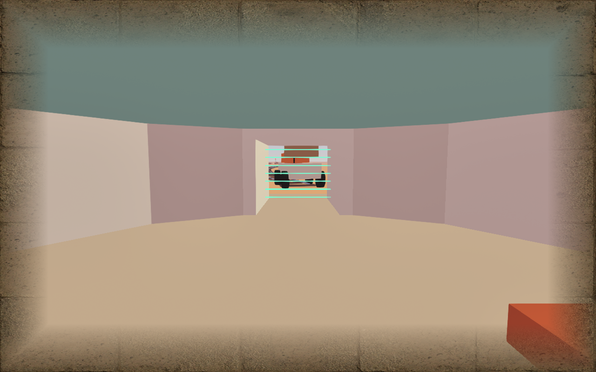

- **Seen:** after the look rewrite in `Rovers`, every editor shot had a brown
  stone border and a washed-out picture.
- **Cause:** the ink shader had a variable named `line`. That's a reserved word
  in HLSL, so the material failed to compile and Unreal drew its fallback
  material over the whole screen.
- **Found by:** turning post-process settings off one at a time until the
  frame went away.
- **Fix:** rename the variable. The bridge's ink shader was written later with
  the same rule: never name a variable `line`.

### 2. Unreal's build rejected the generated C

- **Seen:** the plugin wouldn't compile.
- **Cause:** Unreal's build settings turn the "unreachable code" warning into
  an error, and generated C has unreachable returns.
- **Fix:** the module that compiles the rules turns that one warning off.

### 3. Imported meshes had fewer triangles than we exported

- **Seen:** the importer's own triangle check failed.
- **Cause:** Unreal's glTF import turns Nanite on, and reading a Nanite mesh
  back gives the simplified fallback. Nanite also isn't available in the web
  build.
- **Fix:** the importer turns Nanite off on every mesh.

### 4. A few triangles still went missing

- **Seen:** after a change to the raider model, one mesh came in short.
- **Cause:** the model had triangles with two corners at the same point.
  Unreal's import drops those, and an import option that looked like it would
  keep them made no difference.
- **Fix:** the exporter leaves them out. They have no area, so nothing changes
  on screen, and every mesh now imports triangle for triangle.

### 5. The reference shots were zoomed wrong

- **Seen:** Unreal's check shots showed the right scene at the wrong zoom.
- **Cause:** Unreal keeps the vertical field of view fixed by default; the
  prototype keeps the horizontal one.
- **Fix:** the bridge's camera sets "maintain X FOV".

### 6. The HUD fonts didn't draw

- **Seen:** panels and shapes drew; the text didn't.
- **Cause:** the first way we built a font at run time from the font files
  produced nothing on the canvas.
- **Fix:** build a transient `UFont` and fill in its composite font from the
  two imported font faces (Michroma and IBM Plex Mono).

### 7. One web package shipped without the designer's table

- **Seen:** the web build showed the plain raiders, not the cones.
- **Cause:** we had moved the overrides table aside for a different test while
  the cook was running.
- **Fix:** cook again. The import report lists the override rows it applied,
  so a missing table shows up there.

### 8. The build refused to run while another editor was open

- **Seen:** the first build of a new project failed with a hot-reload error.
- **Cause:** the `Rovers` editor was open in another window.
- **Fix:** build with hot reload off.

## Tools and AI

- **Claude Code, session one (the Unreal build):** wrote the gap list, the kit
  meshes, the new look and the outdoor world in `Rovers`, and found the `line`
  bug by bisecting.
- **Claude Code, session two (the prototype):** built the prototype of the
  whole run with our OpenAgents tools during the day.
- **Claude Code, session three (the bridge):** compared the two sessions, wrote
  the specification, then built the exporter, the Unreal plugin and the
  importer, and ran every check.
- **Unreal Engine 5.9 source on this Mac:** read to learn how glTF import, the
  web target and the HUD canvas behave. No engine code is copied or changed.
- **Unreal's own web test harness** (`webrun.py`): runs the packaged web build
  in headless Chrome and returns screenshots and logs.
- **Chris:** made the call to stop copying by hand and bridge.

## Numbers

| What | Value |
|---|---|
| Time from the decision to the run playing in Unreal's web build | About 2 h 20 min |
| Static world | 59 meshes, 24,242 triangles, 30 collision boxes |
| Check shots against reference pictures | 6 of 6: outlines agree fully, colour differs by under 0.25 of 255 |
| Scripted run inside Unreal | 11 of 11 hashes match, in the editor and on both web tiers |
| Bridge's own work per frame, web build, party scene | About 1 ms; the frame holds 16.67 ms (60 Hz) |
| Time to rebuild the prototype after a change | About 8 s |
| Time to package Unreal's web build (bare project) | 442 s, about 7.5 minutes |
| First-visit download, prototype page | 443 KB |
| First-visit download, Unreal web build (Development) | 72.7 MB |

The last two rows are why the prototype is where we try things, and Unreal is
where we ship.

## Departures from the brief, to confirm with Kiki

- **The bridge is a C++ plugin.** The brief says Blueprints only. The plugin
  hosts the rules; it holds no game logic of its own.
- **The rules run as hosted C, not as Blueprints.** We need to confirm the jam
  accepts this. If it doesn't, the fallback is the `Rovers` project from build
  note 0006 with the new look and world from Part 1.
- **The bridge runs in its own bare Unreal project** for now, not in `Rovers`.
  Moving it in is a copy of the plugin folder plus one import.
- **Tier 2 is in:** the title screen, the village and scanner gate, and the
  rail ride came across with the prototype.

## Known rough edges

- No cast shadows, glow, clouds or stars on the Unreal side yet.
- Ink lines draw on outlines only, not on inner edges.
- The baked Unreal models don't animate; the rules still move them as whole
  pieces.
- The sound event fires, but we haven't confirmed it's audible in the web
  build.
- The whole run has been played by script. With real keys we've started
  from the title, driven the rail and toggled graybox mode, not yet played the
  full run.
- The rebuilt `Rovers` level from Part 1 has no game logic for its new layout.
- One frame-time re-measure read 33 ms. The Mac was on battery at 17 percent,
  which halves the browser's frame rate, so we don't count it. It needs
  measuring again on mains power.

## Next

- Ask the jam whether hosted rules are in bounds, and pick `Rovers` or the
  bridge project as the one we ship.
- Swap in Kiki's Drop 1 models and sound through the overrides table.
- Cast shadows and glow in the Unreal look.
- Play the whole run in the web build with real keys.
