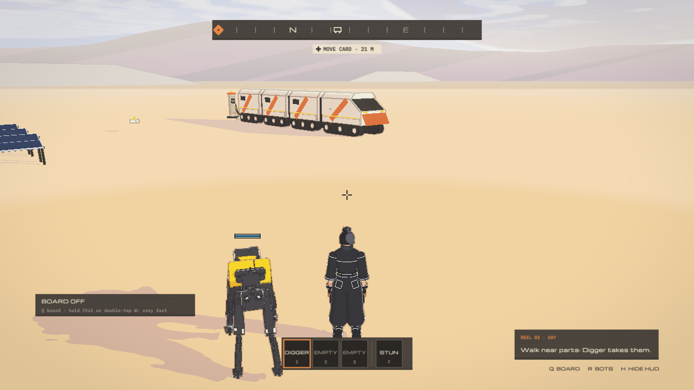
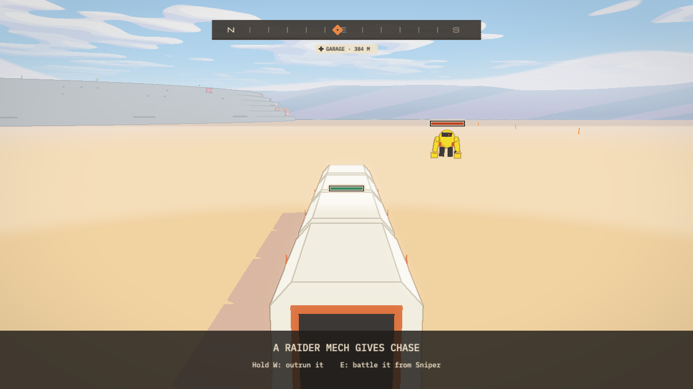
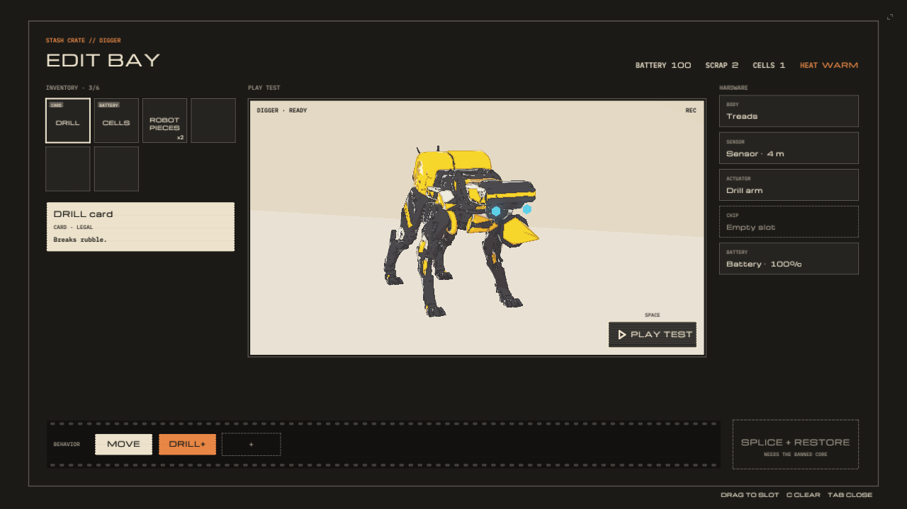
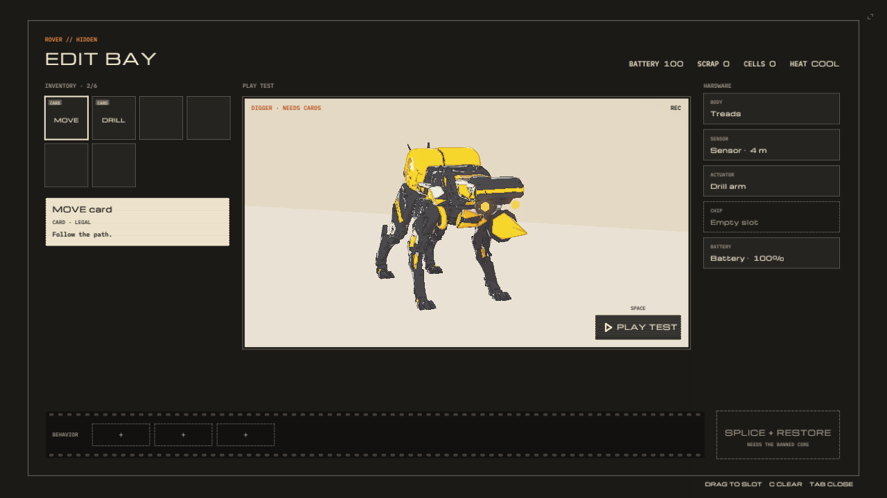
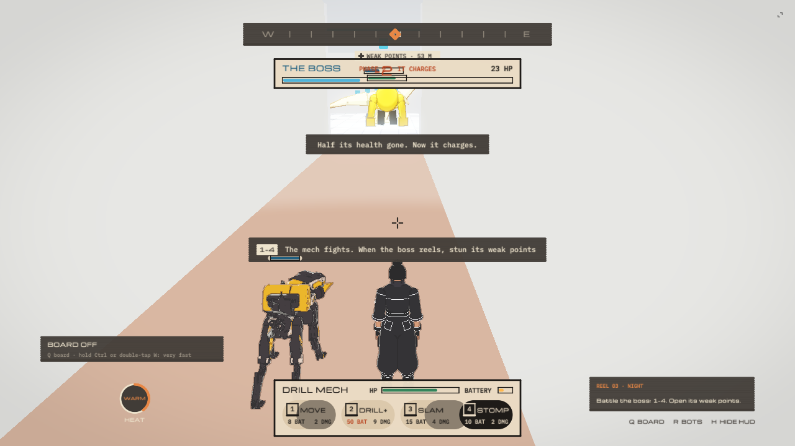
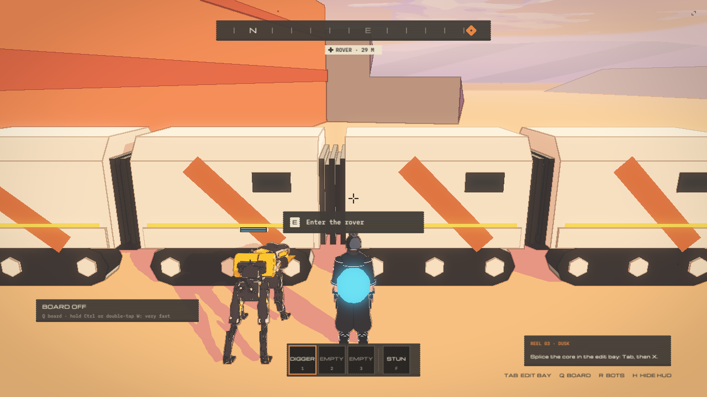

[Home](../index.md) · [Devlog](../devlog.md) · [How We Used AI](../how-we-used-ai.md) · [Play](../play.md)

# 0008: The feel pass, three playtests, and what they found

Date: 2026-11-13 to 2026-11-14 (ET)
Session length: two days, most of it agents working in parallel while we played

## Goal

Build note 0007 left us with a full run that plays from the title to SCENE
RESTORED. It worked, and it didn't feel good. For two days we did one thing:

- **Play it, say what's wrong out loud, fix it, play it again.** Three recorded
  playtests, each one turned into a list of fixes.

This note covers the browser prototype of slice 1. The same world plays inside
Unreal through the bridge from note 0007. The Unreal build has to be rebuilt to
pick these changes up, and that rebuild isn't done yet.

## Where it is now

| The start: the solar farm, the rover and Digger | Driving the rover to the garage |
|---|---|
|  |  |

The slice is one loop:

1. Wake at the solar farm. Walk near parts and Digger, your robot, picks them up.
2. Open the edit bay in the rover and splice the parts and cards into Digger.
3. Order Digger to dig out a buried sensor.
4. Take the wheel and drive the rover across the desert to the garage.
5. Drill through a rock wall, find the blocked hallway, and fight the boss in a mech.
6. Splice the banned core. The memory plays. SCENE RESTORED.

## What changed in the feel pass

- **Movement.** Sprint, a hoverboard, and (as of today) a crouched sneak on
  Left Shift. Sneaking is 45% speed with a lower camera, and Imperial robots
  notice you from half as far.
- **Camera.** It blends between on foot, inside the rover, driving and the
  boss room, and the rover's walls stop it. It no longer swings top-down when
  you walk up to the mech.
- **Driving.** You drive the whole rover train yourself: steer, handbrake,
  park, get out.
- **Digger.** He takes orders from the reticle (near, far and blocked targets),
  says so when he can't do something, and follows you. Today he learned to walk
  round the solar rows by the aisles, where before he walked through the panels.
- **Enemies.** Raiders chase the rover on the road. Imperial robots patrol.
  Bots that fight at close range push each other apart now and no longer overlap.
- **The compass.** It leads you to the next objective, and round the parked
  rover train to its door.

## What broke

### The bay said READY when Digger couldn't do anything

| Before | After |
|---|---|
|  |  |

- **Seen:** with the hardware in but no behaviour cards on the strip, the edit
  bay said READY.
- **Cause:** READY only looked at the hardware slots.
- **Fix:** it says NEEDS CARDS until the strip has a card.

### The boss fell in 12 seconds

- **Seen:** an agent played the whole slice with real keys in a headless
  browser. The boss was dead in about 12 seconds and never landed a hit.
- **Cause:** one stun could be held open by pressing F again, so the boss
  never got a turn.
- **Fix:** after a stun it ignores more stuns for 4 seconds, and F no longer
  extends one. It sweeps and charges between openings. A simulated player now
  wins in about 30 seconds.
- **Not done:** playtest 3 (below) shows the fight is still confusing to a
  person. Harder is not the same as clearer.

### The compass pointed through the rover

- **Seen:** from the far side of the parked rover train, the compass pointed
  straight at the door, through the train.
- **Cause:** it drew a straight line to the target.
- **Fix:** it uses the same route graph Digger uses, so it leads round the
  train's nearer end.

### Digger walked through the solar panels

- **Seen:** told to fetch a part one row over, Digger refused. Left to follow,
  he walked through the panels.
- **Cause:** his path search covers 20 m. A solar row is about 150 m long, so
  "round the end" was out of reach.
- **Fix:** a coarse graph of the aisles for long walls, shared by anything that
  walks.

### The camera aimed from the wrong place after a respawn

- **Seen:** in the end-to-end run, a click on the rock wall aimed from the yard.
- **Cause:** the camera was still blending from where she had been before she
  was moved.
- **Fix:** a respawn or a move ends the blend.

### A test that failed only when the build machine was busy

- **Seen:** the game's test suite went red at random.
- **Cause:** two checks each replayed the whole run 4 to 14 times and ran past
  a two-minute limit on a loaded machine.
- **Fix:** one or two replays a check. The slowest now takes about 5 seconds.

### We waited on tests when we should have been playing

- **Seen:** on the morning of Nov 14 we wanted to playtest four fixes. The
  agent doing them had spent 90 minutes waiting on full test runs and had
  pushed nothing.
- **Cause:** it was holding all four fixes for one combined, fully tested push,
  on build machines shared with five other agents.
- **Fix:** Chris told it to stop waiting and ship ("I don't care if it's a
  little buggy"). It pushed in ten minutes, we rebuilt in 73 seconds and
  played. The tests ran afterwards and passed. For a jam, play first.

## Playtest 3 (Kiki, Nov 14, 13 minutes)

Kiki played the whole slice start to finish, talking the whole time, and
finished it. We transcribed the recording and worked from the transcript.

What she liked:

- being inside the rover, and the rover being wired to its battery
- driving across the desert
- Digger's dig animation ("Digger's going to dig. That could be on a t-shirt.")
- walking near parts and having Digger take them

What she found, grouped:

| Area | Finding |
|---|---|
| Look | The solar panels flash white lines when the camera moves. The garage should be dark concrete. Its LEDs should be yellow and only on at night. |
| World | Each garage section should have a loft floor with stairs and parts worth finding. The blocked hallway should use the same rubble as the first wall. Openings should fit a mech. |
| Time of day | Raiders should only be out at dusk and dawn; one chased her in daylight. Night should fall when the wall comes down, and bring many more enemies. |
| Enemies | Imperial robots shouldn't stand in the solar farm. They should roam far off and look huge. |
| The boss | She was hit without seeing by what, couldn't find the glowing weak points, and didn't understand the prompt. |
| Controls | Esc didn't close the edit bay. She didn't know how to get off the hoverboard. The sprint hint named a key her keyboard doesn't have. |
| Digger | She lost him in the garage. She wants every robot to follow or go to the inventory, and to see him running beside her when she goes fast. |
| The bay | After a splice she wanted to be told it would work, and then be offered the order. |
| Inventory | The beaten mech's body and the dinosaur's body should become parts she can swap in. |
| The end | Show how long the run took. |

We wrote these up as one list and have not started on them. With a day left,
we'll choose which ones make the jam build.

## Tools and AI

- **Agents in parallel.** One coordinating agent (Claude) handed each problem
  to its own agent, up to nine at a time on a Mac plus more on a Linux box.
  Each agent worked in its own copy of the code and pushed when its change
  passed.
- **One issue a complaint, or one issue a playtest.** Everything said in a
  playtest became a written item with a "done when" line before anyone touched
  code.
- **An agent as a playtester.** One agent played the slice in a headless
  browser with real key and mouse input, no teleports, from the title to the
  ending. It found the camera and compass bugs above before a person did. It
  did not find anything Kiki found about feel.
- **Transcription.** The playtest recordings are screen captures with voice.
  We pull the audio out with ffmpeg and transcribe it on the Mac with Whisper
  (medium English model). A 13-minute playtest takes about a minute.

## Numbers

- 1,219 checks in the game's test suite, all passing at the last full run.
- The release build of the game is 1,019,737 bytes against a limit of 1,030,000.
- A rebuild of the prototype takes 23 to 73 seconds.
- Playtest 3: 13 minutes, start to SCENE RESTORED.

## Next

- Choose from playtest 3 what goes into the jam build. The boss's clarity and
  getting off the hoverboard are the two that stopped her.
- Rebuild the Unreal build with the feel pass in it and play it there.
