[Home](../index.md) · [Devlog](../devlog.md) · [How We Used AI](../how-we-used-ai.md) · [Play](../play.md)

# 0009: The Unreal rebuild, and the playtest that broke it

Date: 2026-11-14 to 2026-11-15 (ET)
Session length: about 22 h, two machines, agents working in parallel most of it

## Goal

Note 0008 ended with the browser prototype feeling right and the Unreal build still to be rebuilt. We stopped
bridging the prototype into Unreal and rebuilt slice 1 natively in Unreal Engine 5.9 (the SPLICEBOTS project), from
a written game design document, with AI agents doing the building. Then Kiki played it.

## Where it is now

| The new title, in the prototype's style | The farm start |
|---|---|
| 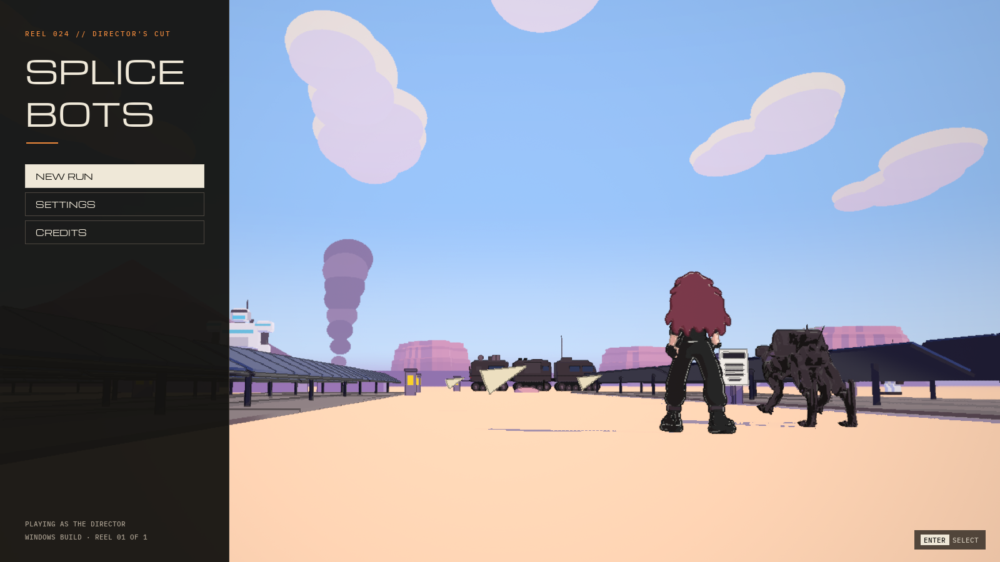 | 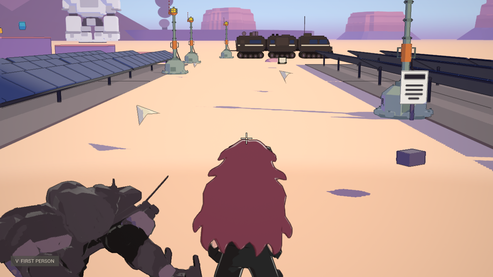 |

## What's working: a gallery

| Riding the board at the solar farm, with Digger, Sniper and the Imperial robots | Driving Sniper toward the garage at dusk |
|---|---|
| 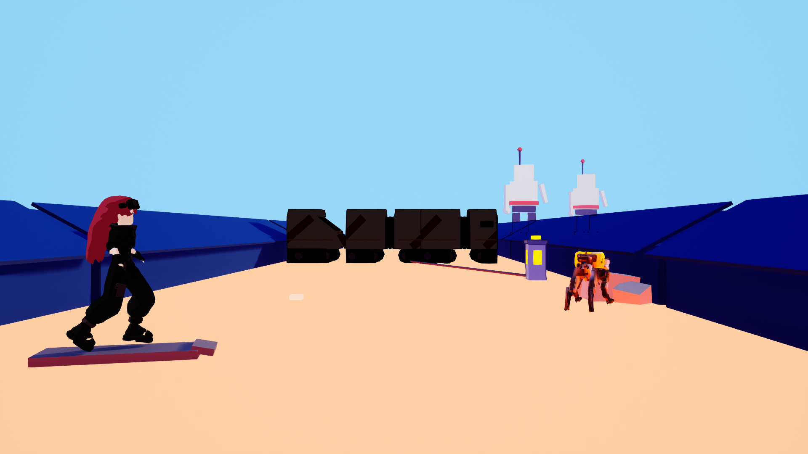 | 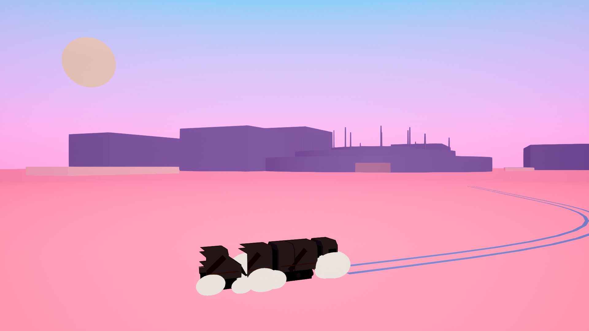 |

| The night rave in the garage | Digger drilling through the rock wall |
|---|---|
| 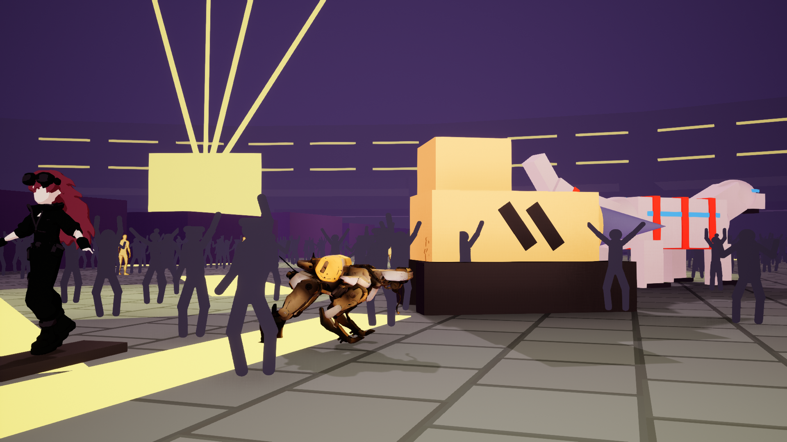 | 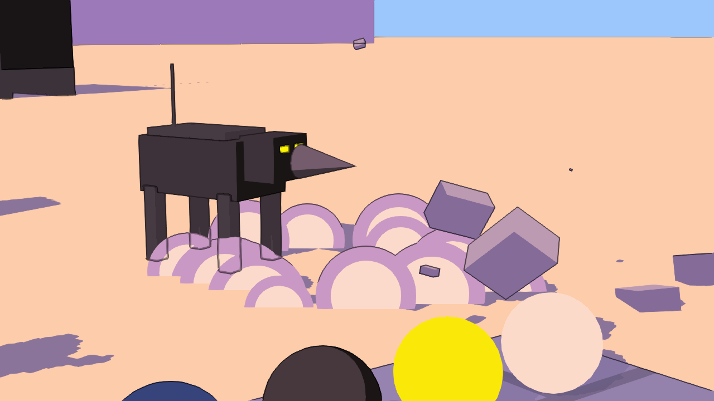 |

| The village: the chapel plaza | The village: the skate plaza, kickers and a launch ramp onto a roof |
|---|---|
| 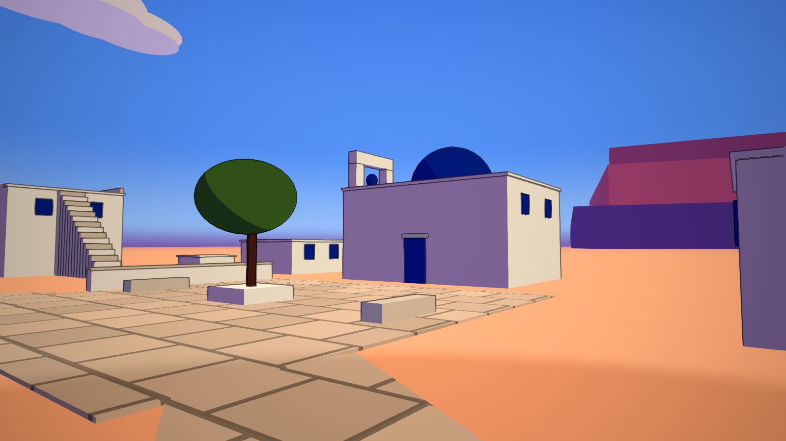 | 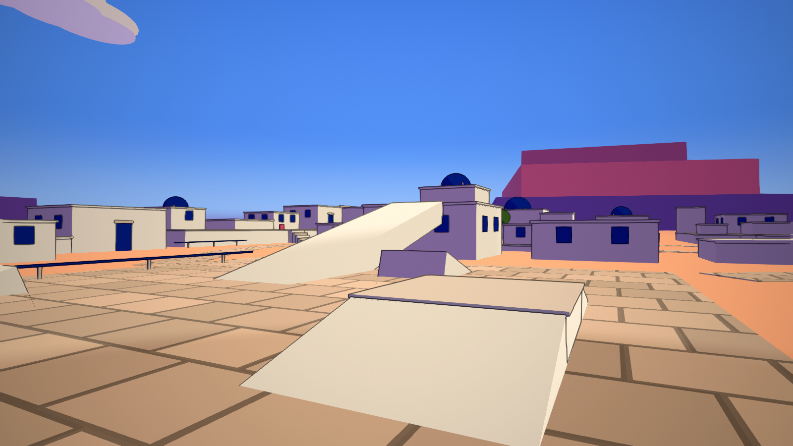 |

| The whole village from above | An Imperial robot's footfall |
|---|---|
| 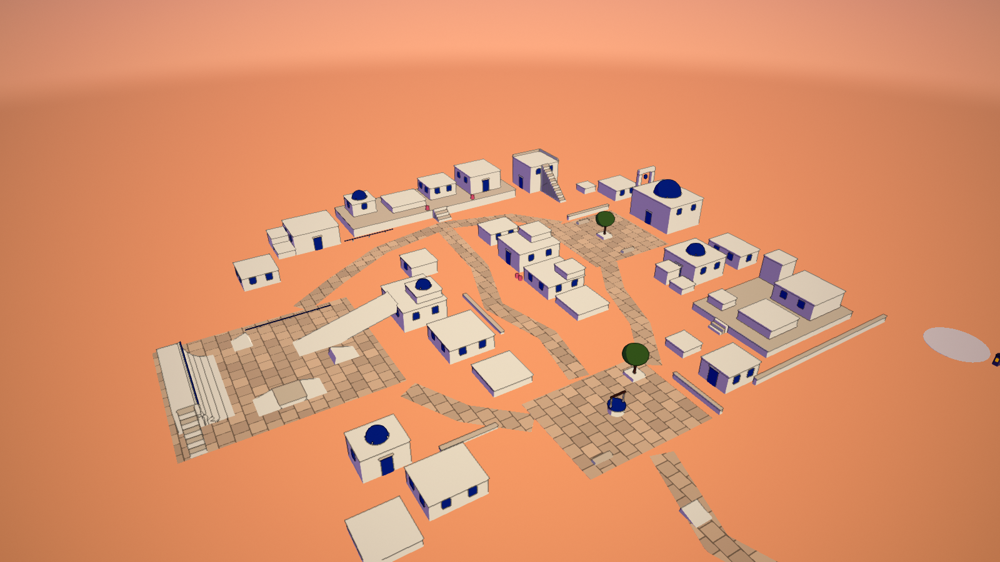 | 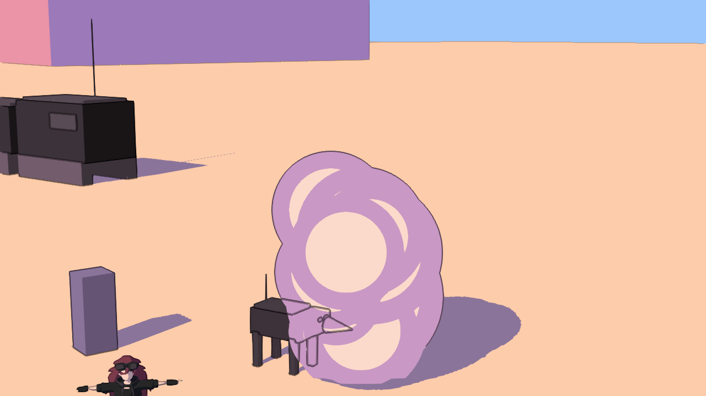 |

| The hotbar icons, drawn by script | |
|---|---|
| 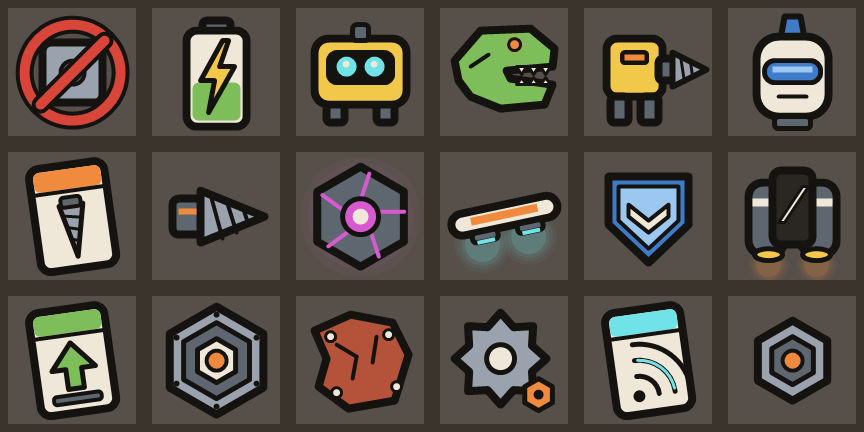 | |

## Steps

1. Nov 14, 2:20–3:48 PM: a game design document for the Unreal rebuild, written from the prototype, the beat sheet,
   the art bible and the designer's addendum on cores and cards, then a delegation plan: 124 work packages for AI
   agents in 11 tracks.
2. 3:58 PM: the empty Unreal project. From here two Claude Code sessions worked in parallel, one on Chris's Mac and
   one on Kiki's Windows PC, each running several sub-agents.
3. Overnight: movement, camera, the hoverboard, Sniper the rover, Digger and the robots, Heat, the inventory and the
   edit bay, the HUD and menus, the story flow, save, music, the levels and the comic look.
4. Nov 15, 3:12 AM: **the whole slice plays start to end in Unreal**: title, farm, drive, garage, boss, core, SCENE
   RESTORED. A scripted run with real key presses passes on keyboard and on controller.
5. 4:38 AM: the first release build, smoke-checked. This is our **backup build**.
6. Morning: Kiki's first playtest of the Unreal build, and a batch of fixes from it: a title in the prototype's style,
   drawn hotbar icons, a crosshair, faster running and higher jumps, hoverboard animation, tricks and ramps, the
   rover's cab drives and its cars go inside, robots fetch parts and stay or follow on command, feeding a robot a
   battery, Esc to pause, and a white Greek-style village with plazas and skate ramps.
7. 11:29 AM: a jetpack (grey box for now; the designer's model is coming), a 2.5x faster hoverboard, a pickup chime.
8. Around noon: Kiki's second playtest. It broke (below).
9. Afternoon: four agents compared the prototype's code to the Unreal build, feature by feature: 405 behaviours. Six
   more agents are now folding everything missing back in.

## What broke

### She disappeared, and the world went pink

| Her, invisible, with only the jetpack showing | Fallen below the world |
|---|---|
| 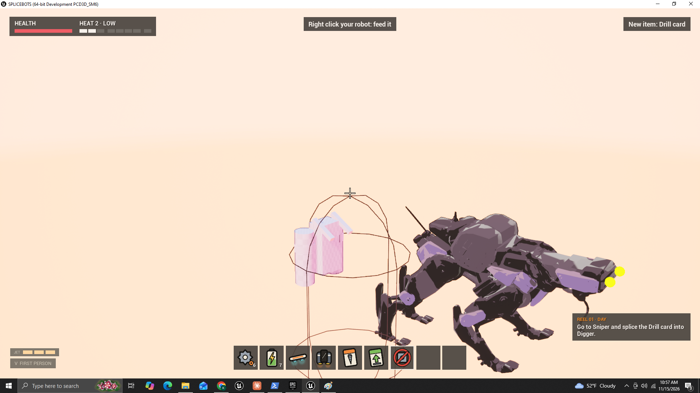 | 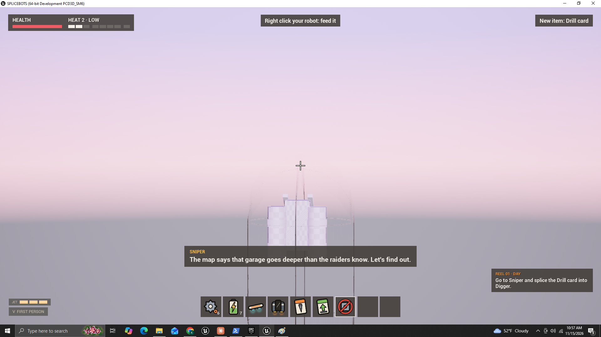 |

- **Seen:** after driving the rover and getting out, her body was gone: just her collision outline and the jetpack,
  which drew as a pink checker. The whole picture was washed out in peach and pink.
- **Cause:** getting into the rover hides her and freezes her movement. Only the normal "get out" put that back; a
  cutscene or a level change on the way out left her hidden. The jetpack is built from engine shapes whose material
  wasn't packaged. The haze is several things stacked: fog that barely thins with height, a warm rim added to far
  ground the night before, and colour grades tuned for still screenshots that also apply in play.
- **Fix:** whenever she is the player again, she's shown, collides and can move, whatever path brought her back
  (`SplicePlayerController.cpp`). The shapes' material is now packaged. The haze is being fixed now.

### The transport bug

- **Seen:** Kiki drove the rover, hit a cutscene that broke her movement, got out, found her character gone and
  Digger back beside her, and was then put inside the garage without walking there.
- **Cause:** to hit the deadline, the Unreal build split the world into separate maps (farm, plain, garage, lab) and
  jumps between them: cross the farm's edge while driving and the plain loads; come near the garage and the garage
  loads. The design is one world you can walk across. Each jump rebuilds her and her robots in the new map.
- **Fix:** in progress: one continuous world, with no loads during the story.

### The rover wouldn't let her in, and Digger vanished

- **Seen:** the edit bay couldn't be reached; Digger disappeared when the story sent him to the rover.
- **Cause:** the rover sent every click anywhere on it to the steering wheel. Digger had been told to stay by a held
  right click that kept retrying as the aim slid onto him.
- **Fix:** the cab says DRIVE, the cars say ENTER; a held click no longer gives orders.

### Tests passed while the game was broken

- **Seen:** 379 automated tests passed on the build Kiki found broken.
- **Cause:** the tests check positions, speeds and states, not the picture.
- **Fix:** every build is now played and looked at before it's handed over.

## Backup or current build

- **Backup** (4:38 AM): plays start to end in our scripted run; none of today's playtest features.
- **Current:** everything Kiki asked for today, plus the breakage above, which is being fixed.
- **Decision:** we're not submitting yet. We finish the prototype-parity work, play it ourselves, and decide then.

## Tools and AI

- **Claude Code (Claude Opus):** nearly all the Unreal C++ and its tests, the editor and Blender scripts, the
  procedural music and Sniper's voice chirps, the drawn icons, the design documents and the parity audit. Up to ten
  sub-agents at once, each owning one area of files.
- **Tripo:** her body and Digger, from the designer's images; the next models (jetpack, hoverboard, raiders, parts)
  are cut and queued.
- **Blender, driven by script:** the mesas, the garage, the Imperial robots, the beacon posts, the rover's three cars,
  the dinosaur and the mechs.

## Numbers

- **12 h 14 min** from the empty project to the slice playing start to end in Unreal.
- **About 210 commits** in the Unreal project by Nov 15 afternoon.
- **379 automated tests** passing, and still a broken build: the reason for the new play-check rule.
- **405 behaviours** compared between the prototype and the Unreal build: 83 matched, 137 differed (many on purpose),
  147 missing, 38 likely broken.

## Next

- Everything the prototype did, folded into the Unreal build or marked as replaced, with today's upgrades kept
  (jetpack, faster board, crosshair, the village).
- One world, no level jumps; the haze gone; the compass and map back; sound in.
- Play it ourselves against the prototype, then decide on the jam build.
