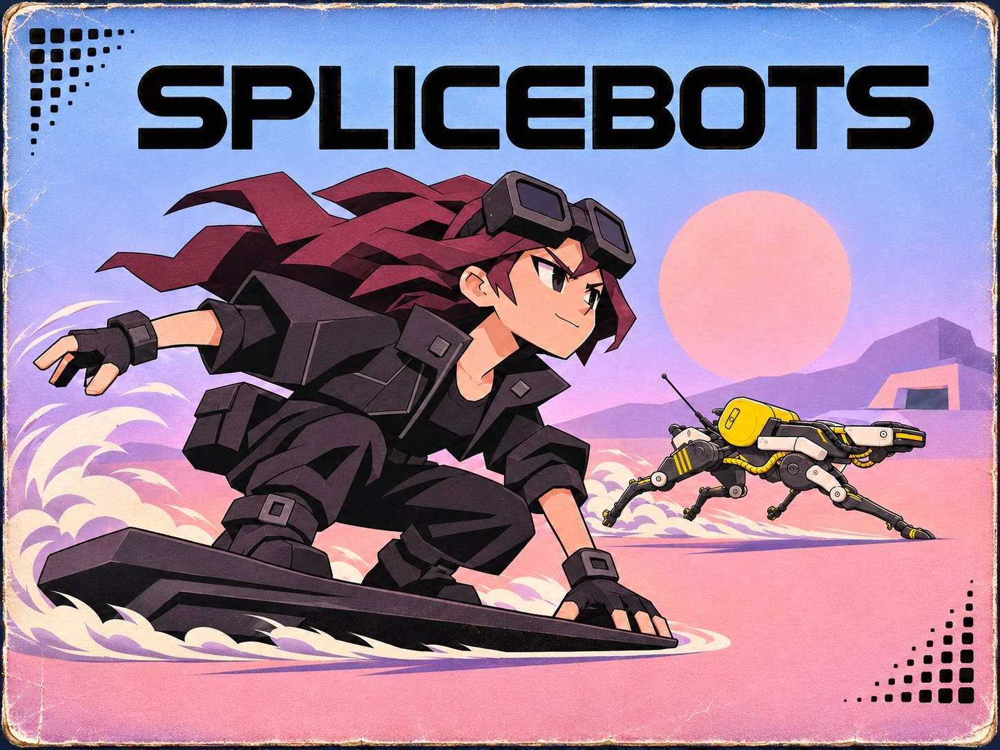
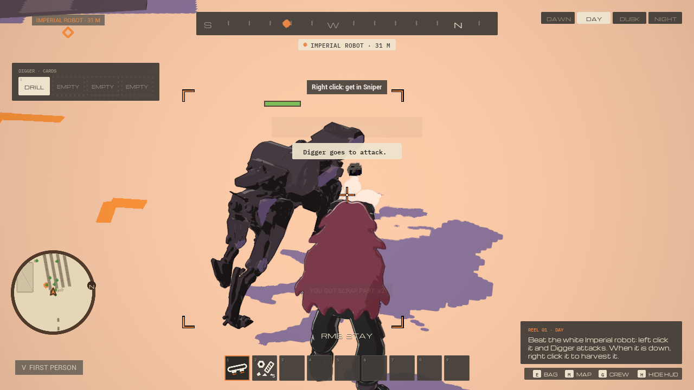
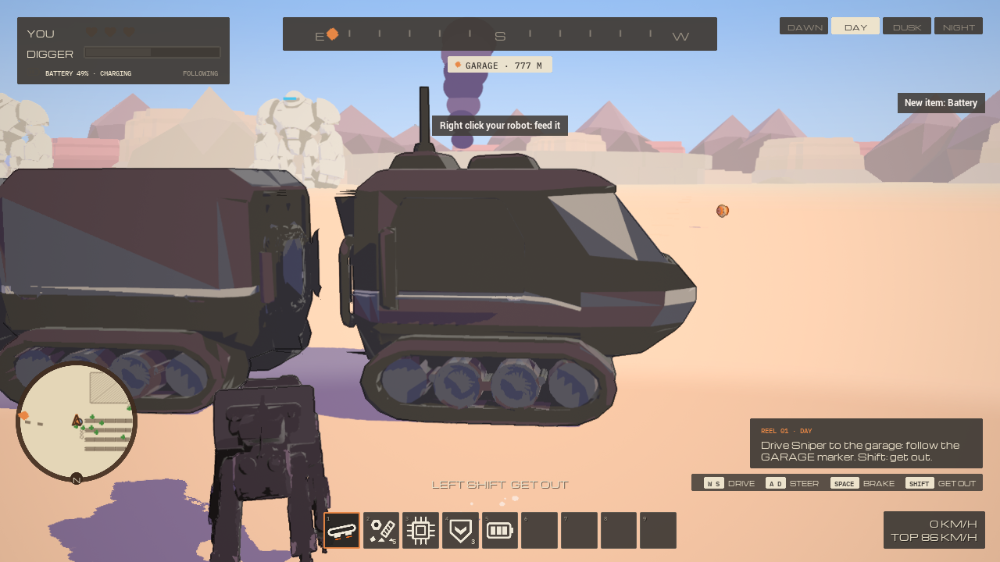
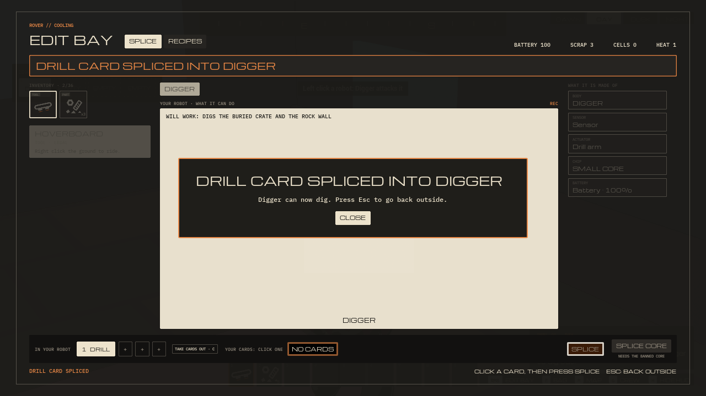
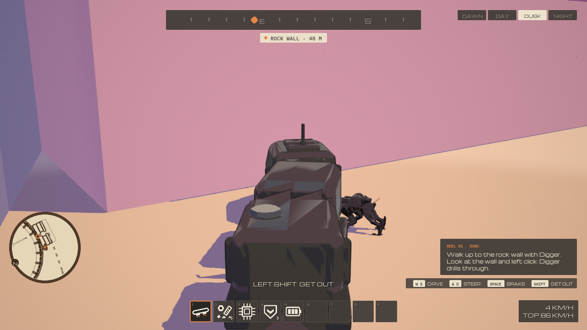
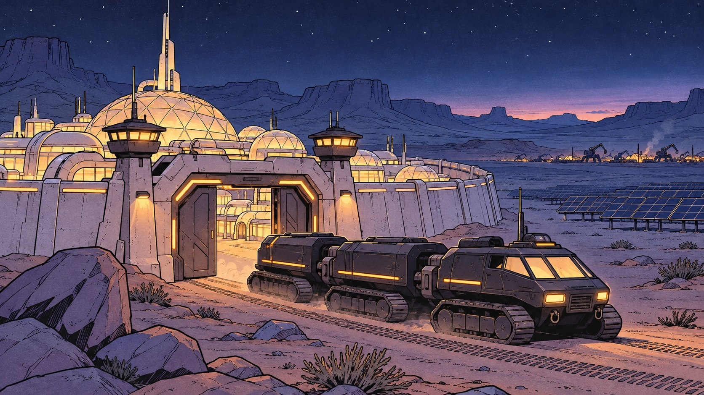

[Home](../index.md) · [Devlog](../devlog.md) · [How We Used AI](../how-we-used-ai.md) · [Play](../play.md)

# 0010: Submitted

Date: 2026-11-15 (ET)
Session length: about 4 h since note 0009, two people and up to six AI agents at a time

## Goal

Note 0009 ended with "we're not submitting yet". Since then we folded the prototype back into the Unreal build, fixed
what three more playtests found, and packaged a release build. Kiki played it start to win. We submitted it. We're
happy with it. We may post an update build later; the list is at the end.

## Where it is now

| On the farm: Digger goes to attack on a click | Sniper, ready to drive to the garage |
|---|---|
|  |  |

| The edit bay tells you when you're done | The city she is trying to remember (Kiki's concept art, going into the ending) |
|---|---|
|  |  |

## Steps

Times are US Eastern.

1. 2:00 PM: Kiki's playtest of the "winnable" build. She could not get into the rover (below). Digger vanished. Our
   claim that it was winnable came from a scripted run that put her in the seat directly.
2. 2:10–3:40 PM: the rover fix, a guided edit bay (a step line, the next button pulsing, a big "DRILL CARD SPLICED
   INTO DIGGER" panel), on-screen markers for the objective and for Digger, calmer light in the cabin, a settings
   screen that works, shorter battery posts.
3. 3:00–4:00 PM: an RDR2-style map: a parchment minimap that turns with the camera, and the whole world on M with
   waypoints. Hoverboard brake, reverse and crash. Imperial robots that patrol. A day and night schedule for the
   raider mech. A mountain horizon. The quarter in the farm's colours.
4. 3:30 PM: Chris played start to win for the first time and asked: "I just walked through the middle of the crowd.
   Is this how the design has it?" We compared the game to the design document. The crowd is harmless on purpose; the
   rest was far too easy, and the biggest reason was a win shortcut we had added that morning to get a winnable
   build.
5. 3:40–4:10 PM: the designed difficulty back in: Heat reaches High with the dinosaur taken, faster Imperial robots
   that hit everything in their swing, robots that die at 0 and are rebuilt at the edit bay, and no win by waiting.
6. 4:10 PM: an automated player (below).
7. 4:20 PM: a ruling: where the prototype and the design document disagree, the design document wins. Six prototype
   features the design had withdrawn went off behind switches.
8. 4:37 PM: **the release (Shipping) build**: packaged, zipped (319 MB), unzipped into a clean folder and started as
   a check.
9. 4:57 PM: **Kiki played a build to the win.** Her note: "I won the game. It was great... so many cool things
   work."
10. Submitted.

## What broke

### The rover would not let her in

- **Seen:** Kiki reached Sniper with the Drill card and clicked it six times. Each time a card said to splice the
  Drill first, and she stayed outside.
- **Cause:** the rover refused to be driven before the Drill was spliced. The only place to splice it is the edit bay
  inside the rover. The game was asking for something it made impossible.
- **Fix:** before the Drill is spliced, a click anywhere on Sniper takes her into the cabin; only driving waits
  (`SpliceRover.cpp`).

### Digger and the drill mech were there, but not drawn

- **Seen:** Digger "disappeared" in four playtests. The log said he was 2 m from her, on the ground, not hidden.
- **Cause:** a rule that hides him when the camera is inside him used a loose box round his whole posed body, and his
  place is right behind her, between her and the camera. The drill mech's body is built when a robot enters the
  world, and in the one continuous world the mech arrives a moment later with the garage, so it never got one.
- **Fix:** he hides only when the camera is truly inside his body; a sweep gives late robots their bodies. A second
  cause, her jetpack's lift being read as a jump and launching him, was capped.

### Sniper stuck against a wall nobody could see

- **Seen:** the rover curled up against nothing at the world's north edge and could not move either way.
- **Cause:** the edge wall stood 1 m past the warning stakes, and a three-car rover jackknifes against a flat wall.
- **Fix:** the walls stand 400 m further out, and a rover that has not moved for 2 s with a key held is straightened
  out and set down facing the garage.

### The marker led into a wall

| What the automated player found on its second run |
|---|
|  |

- **Seen:** driving to the GARAGE marker ended against the garage's outer wall, 48 m short.
- **Cause:** the marker pointed at the rock wall inside, in a straight line through the building.
- **Fix:** the drive's goal is the yard, the way in.

### Tests passed while the game was broken (again)

- **Seen:** the scripted run passed 6 of 6 on the build with the rover she could not enter.
- **Cause:** it teleports to each beat. It never walks up to anything and clicks.
- **Fix:** the automated player.

## The automated player

It plays the packaged game from the title with the same keys and mouse a person uses. It never teleports and never
sets state. It reads the objective, turns to the marker, walks or drives there, and presses what the prompt offers. In
the edit bay it clicks the control the guide is pulsing.

On its first run it took the Drill card, clicked Sniper, did the splice, left by the door, sent Digger at the Imperial
robot, harvested a battery, got in and drove to the garage, in 82 seconds. On its second it found the marker that led
into a wall. It reports being stuck, a prompt that does nothing, an objective with no target, a robot that should be
on screen and is not, and falls. It now also records every frame of a run and looks for a screen that goes one flat
colour, a flash, a frozen picture and a camera inside a wall, because Chris saw a lavender flash on leaving the rover
and wanted that caught without a person watching.

## Tools and AI

- **Claude Code (Claude Opus, then Fable):** the lead session read each playtest's game log, found the cause, fixed
  it or briefed an agent, and did every build. Up to six sub-agents at once, each owning its own files: the map, the
  robots, the world, the look, the hoverboard, the story and sound, the boss's movement, the difficulty, the
  automated player. One rule kept it from falling over: only the lead packages and launches builds.
- **Two audits, both by agents reading code:** the game against the prototype (every row now built or marked as
  replaced), and the game against the design document (about 2,090 requirements: 777 done, 505 partly, 148 missing,
  101 changed on purpose, the rest needing a play check).
- **Synthesised sound:** the menu ticks, the jetpack, the battery feed and three music beds are rendered by a
  script, as placeholders. Nobody had heard them before the build went out.
- **Tripo and Blender by script:** as before; the drill mech now wears its model.
- **Kiki:** every playtest, the design rulings, and the concept art for the ending.

## Numbers

- **6 playtests** today by two people, and 12 packaged builds.
- **Start to win** by a person: done, twice.
- **357 rule tests and 39 wiring tests** passing on the final source, after two real finds: a controller player
  could not send robots at range, and the master volume slider was missing from the sound data.
- **82 s** for the automated player to go from the title to the garage.
- **319 MB** zipped; 463 MB unpacked; Windows desktop.

## Next

We are happy with what we submitted. If we post an update, it is Kiki's list from her winning run:

- The way out after the boss as a real fight: many Imperial robots, a sealed exit, then outrunning them in Sniper.
- Crafting and splicing as the last step before the memory is restored, and a clearer edit bay built round the robot.
- The closing scene made from the concept art, in place of blocks.

| The night she left: the last picture of the new ending |
|---|
|  |

- The distant buildings as the printed domes in that art; stairs in the garage that read as stairs.
- The drill mech fed and told to stay like Digger; Imperial robots walking everywhere; more batteries in the bays.
- More music.

## Final update, Sunday night

The build we submitted is a later one than this note first described: Shipping package `20261115-190027`, 357 MB zipped.
It folds in most of the list above:

- The way out after the boss is a sealed exit and a fight, then a run to Sniper with Imperial robots giving chase.
- The memory reader is built and spliced in the edit bay before the memory is restored.
- The edit bay shows the robot live in 3D on its stage, at a size you can read.
- The closing scene uses the concept art; printed homes and domes stand in the distance; the garage has stairs.
- The drill mech follows, opens the hallway on a click, and can be told to stay. There is a synthesised score.

What we know and have not hidden: 382 of 382 rule and wiring tests pass on the submitted source, and people have won
earlier builds, but the new ending has not been played from the boss to the restored memory in one sitting in this
exact build. In scripted play the fight out is won by moving, not by standing at the gate. That is the first thing we
check if we post an update.

Thank you for playing.
