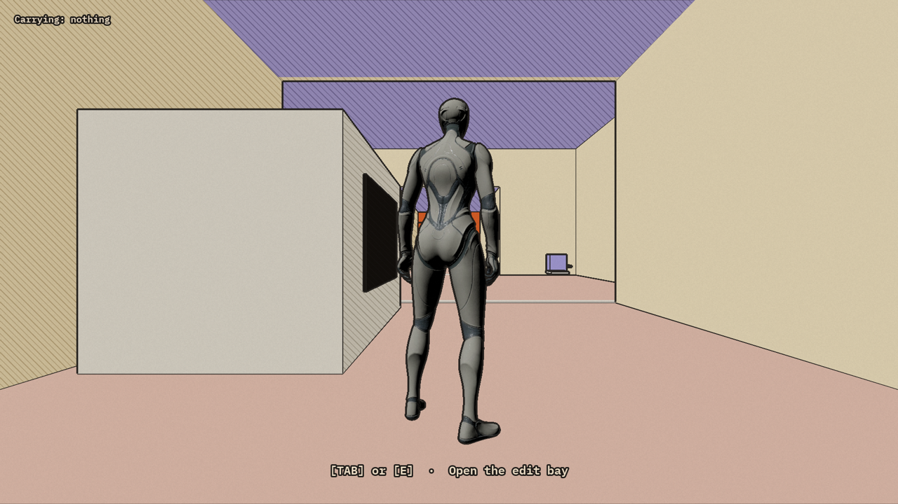

[Home](index.md) · [Devlog](devlog.md) · [How We Used AI](how-we-used-ai.md) · [Play](play.md)

# Splice

**On an Earth left behind, scavenge banned robot parts and splice them back to life in your rover's hidden edit bay, restoring the director's cut the Emperor tried to erase.**

## Watch the devlog

<!-- Final devlog video goes here on Saturday. Replace VIDEO_ID with the YouTube id. -->
<!-- <iframe width="720" height="405" src="https://www.youtube.com/embed/VIDEO_ID" title="Splice devlog" frameborder="0" allowfullscreen></iframe> -->

*Video coming Saturday, Nov 14.*

## Play

**[Play Splice on itch.io](https://itch.io/)** (placeholder: link goes live with the release)

## Where we are

- **Day 0 (Nov 12, from 12:06 AM ET):** concept, plus a Moebius-style comic shader test. [Read](days/day-0.md)
- **Day 1 (Nov 12, from 1:35 AM ET):** the whole gray box loop (scavenge, splice, deploy, end screen) playable start to end. [Read](days/day-1.md)

[All days →](devlog.md)

---

Built by Kiki and Chris in Unreal Engine 5.9 for the Epic AI MegaJam (Nov 12–15, 2026).
[How we keep this log](https://github.com/AtlantisPleb/SpliceDevLog/blob/main/README.md)
